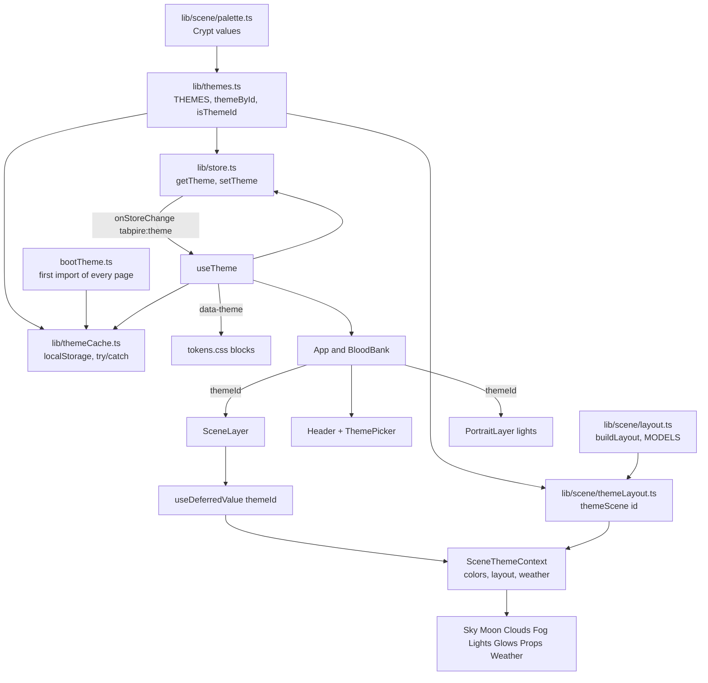
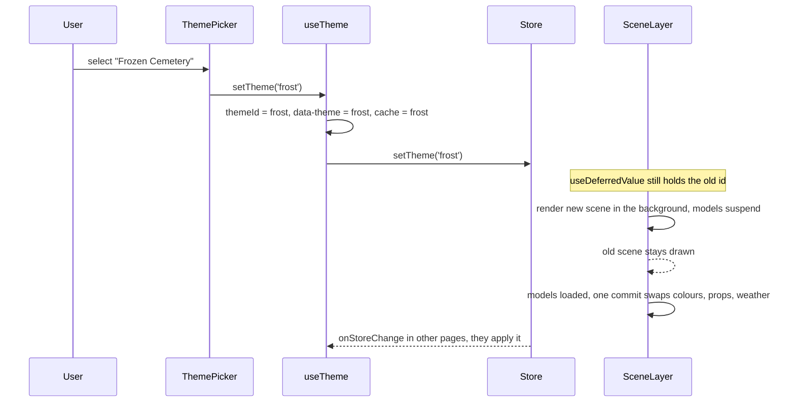

# Design: Themes (Spec 5)

## Overview

Six themes, a Themes panel, and one saved choice that every Tabpire page reads. A theme is data in a pure module, `lib/themes.ts`: scene colours, surface tokens, a prop table and a weather spec. The scene, the CSS and the panel read that data. No component branches on a theme name.

Findings that shaped the design (measured on the code and the model files in this repo):

- **The Crypt already uses some of the "new" models.** `forest_twisted_a/b/c`, `forest_mushroom`, `forest_mushroom_king` and `forest_cauldron` are in `MODELS`. The far village already loads `farm_barn`, `farm_windmill`, `castle_fortress` and `blood_ruins` (two parts) through `FAR_MODELS`.
- **Triangle headroom is small.** The Crypt plan is 157,876 triangles (shadow pass counted) and 123 of 150 draw calls. The limit was 175,000 (17,124 free). This spec raises `BUDGET.sceneTriangles` to 200,000, so a theme can add about 42,000 triangles and 28 draw calls. The Quaternius pines (3,164 to 3,638 triangles each) and the fortress (9,416) are heavy, so every theme adds a handful of props, not a forest.
- **Colours are hidden in shaders and components.** `colors.ts` holds only part of the palette. The moon body, the cloud body and tint, the low-cloud body, the far-village silhouette and the ground colours are literals inside `Moon.tsx`, `Clouds.tsx`, `LowClouds.tsx`, `FarVillage.tsx` and `Ground.tsx`. Four tinted colours (`rgba(10,4,16,0.6)`, `rgba(12,7,20,0.96)`, `#ffb3c4`) are literals in CSS.
- **Some model files need care.** `forest_rocks.glb` sits 194 units off the origin. `castle_torch.glb` has its origin in the middle of the pole (it spans -1.45 to 1.04 in y). `blood_ruins.glb` is a whole scene of 123,181 triangles and 50 units wide, so only the two far-village parts can be used, and they are offset by about 24 units.
- **Pine leaves are alpha-blended textures.** A material `color` multiplies the green texture and cannot make it white, so the snow tint needs `emissive` as well.
- **A source scan guards the 3D code.** `tests/network.test.ts` rejects `fetch(`, `Environment`, drei `Text`, and any `useGLTF` call whose second argument is not `false`. The new model loading follows that rule.

Decisions:

| Decision | Reason |
| --- | --- |
| Themes are data in `lib/themes.ts`. Scene colours, tokens, props and weather live in one record per theme. | One place to read, one place to test. The module imports no browser API, no `wxt/browser` and no `three` (Req 1.7). |
| The Crypt entry is built from the existing exports of `palette.ts`. The literals now inside components move into `palette.ts` and the Crypt entry points at them. | The Crypt cannot drift. A baseline file recorded before any change proves it (Req 2). |
| Non-Crypt themes edit the Crypt layout after it is built (drop, swap, add) with their own seeded stream. | `buildLayout()` is not touched, so the Crypt placement stream and its output stay identical (Req 2.3, 9.7). |
| The scene reads colours and layout from a React context that changes once per switch. Uniforms are updated, not rebuilt. | No per-frame cost. Sky, moon, clouds, fog and lights are not recreated (Req 8, 13.4). |
| The theme switch uses `useDeferredValue` inside the canvas. Each model loads in its own error boundary. | The old scene stays drawn while new files load, and a missing file skips one prop (Req 11, 14). |
| The Sky_Cache stores the Theme_Id only, in `localStorage`. | The Theme_Id selects a `[data-theme]` block, which gives the sky and every other token at once. There is one colour table and no copy to keep in step. |
| Weather is one `THREE.Points` per theme with all motion in the vertex shader. | One draw call, no per-particle JavaScript (Req 10.7). |

No new dependency. No new model file. No network request.

## Architecture



Two things move at different times when the user picks a theme:

- **Active_Theme** (tokens, panel, cards, portrait lights) changes at once, in the same React commit as the click.
- **Shown_Scene** (sky, props, weather) changes later, in one commit, after the new models are loaded.



## Components and Interfaces

### File changes

| File | Change |
| --- | --- |
| `lib/themes.ts` (new) | `ThemeId`, `THEMES`, `DEFAULT_THEME`, `themeById`, `isThemeId`, palette and surface types, prop tables, weather specs. |
| `lib/themeCache.ts` (new) | The only file that uses `localStorage`. `readCachedTheme`, `writeCachedTheme`, `clearCachedTheme`, `applyCachedTheme`. |
| `lib/scene/palette.ts` | Keeps `COLD`, `WARM`, `ACCENT` and `hueOf`. Gains `CRYPT_EXTRA` (the hex literals now in `colors.ts`) and `CRYPT_SHADER` (the linear shader literals and ground colours). |
| `lib/scene/themeLayout.ts` (new) | `themeScene(id, seed?)`: the layout, model list, weather anchors and weather spec of a theme. |
| `lib/scene/weather.ts` (new) | `WeatherKind`, `WEATHER` specs (counts, sizes, speeds). Pure. |
| `lib/scene/layout.ts` | `MODELS` gains the new models. `Group` gains `'themed'`. `WarmSource.kind` gains `'torch'`. `ModelInfo` gains `recentre?: true`. `buildLayout` is not changed. |
| `lib/store.ts` | `ThemeId` and `DEFAULT_THEME` come from `themes.ts`. `getTheme` validates. `setTheme` takes a `ThemeId`. |
| `entrypoints/newtab/bootTheme.ts` (new) | One line: `applyCachedTheme()`. |
| `entrypoints/newtab/main.tsx`, `entrypoints/bloodbank/main.tsx`, `demo/src/main.tsx` | `import '.../bootTheme'` as the first import. |
| `entrypoints/newtab/components/useTheme.ts` (new) | The hook. |
| `entrypoints/newtab/ThemePicker.tsx` (new), `styles/themePicker.css` (new) | The panel. |
| `components/Header.tsx`, `components/HeaderButton.tsx` | The button is enabled. `HeaderButton` forwards a ref and `aria-haspopup`, `aria-expanded`. `Header` gets `themeId`, `onTheme`. |
| `App.tsx`, `bloodbank/BloodBank.tsx` | Call `useTheme()`. `App` passes `themeId` to the scene and portrait hosts and shows the save-failed toast. |
| `layers/scene/themeColors.ts` (new) | `SceneThemeContext`, `useSceneTheme`, `useColorSync`. |
| `layers/scene/colors.ts` | `C` stays (the Crypt set). Adds `sceneColorsFor(id)`. |
| `layers/scene/Weather.tsx`, `ModelBatch.tsx`, `preloadThemes.ts` (new) | Weather points, one model with its own boundary, idle preload. |
| `layers/scene/*` (Sky, Moon, Clouds, LowClouds, FarVillage, Ground, Ghosts, Wisps, CauldronFx, Mist, Embers, Glows, Lights, OpenCoffin, `SceneContents` Fog, Props) | Read colours and layout from the context. Shader literals become uniforms. |
| `layers/SceneLayer.tsx`, `layers/hosts.tsx`, `layers/PortraitLayer.tsx`, `portraits/PortraitLights.tsx`, `portraits/Niche.tsx` | Take `themeId`. The portrait lights and niche tints read the Active_Theme. `portraits/GlowHalo.tsx` (and any portrait code that tints the vampire's own glow) keeps the Crypt values in every theme. The only change is to name its colours as one exported constant so a test can read them. |
| `lib/scene/config.ts` | `BUDGET.sceneTriangles` goes from 175,000 to 200,000 (comment updated). `tests/budget.test.ts` text is updated to match. |
| `styles/tokens.css` | Five new blocks. Three new tokens in every block (see CSS tokens). |
| `styles/cards.css`, `header.css`, `bloodbank.css` | Four literals become tokens. |
| `demo/src/seed.ts` | `resetDemo` also calls `clearCachedTheme()`. |
| `tests/ui/header.test.tsx` | The "disables Themes with Coming soon" test changes (see Tests). |

### `lib/themes.ts`

```ts
export const THEME_IDS = ['crypt', 'pumpkin', 'forest', 'frost', 'bloodmoon', 'castle'] as const;
export type ThemeId = (typeof THEME_IDS)[number];
export const DEFAULT_THEME: ThemeId = 'crypt';
export const isThemeId = (v: unknown): v is ThemeId => typeof v === 'string' && (THEME_IDS as readonly string[]).includes(v);

type Hex = `#${string}`;                        // '#rrggbb'
type Linear3 = readonly [number, number, number]; // linear RGB, the numbers a shader uses

/** Every colour the 3D scene draws. */
export interface ScenePalette {
  // sky and air
  skyTop: Hex; skyMid: Hex; skyHorizon: Hex; haze: Hex; fog: Hex; farSilhouette: Hex;
  // ground
  groundBase: Hex; groundTint: Hex;
  // light
  hemiSky: Hex; hemiGround: Hex; rim: Hex; moonlight: Hex;
  // moon and clouds
  moon: Hex;            // glow
  moonLight: Linear3; moonDark: Linear3;   // the disc
  cloudBody: Linear3; cloudTint: Linear3; lowCloud: Hex;
  // things that glow
  ghost: Hex; ember: Hex; candle: Hex; lantern: Hex; jack: Hex; door: Hex;
  mushroom: Hex; cauldron: Hex; wisp: Hex;
  // weather
  weatherA: Hex; weatherB: Hex;
}

export const SURFACE_TOKENS = [ /* the 41 names in the Crypt block, in file order, plus 'shade', 'popup-fill', 'quote-ink' */ ] as const;
export type SurfaceTokens = Record<`--${(typeof SURFACE_TOKENS)[number]}`, string>;

export type WeatherKind = 'snow' | 'ash' | 'fireflies' | 'leaves' | 'embers';

export interface Theme {
  id: ThemeId;
  name: string;
  description: string;          // one line, plain words, for the panel
  scene: ScenePalette;
  surface: SurfaceTokens;       // equals the theme's block in tokens.css (tested)
  props: ThemeProps;            // see themeLayout
  weather: WeatherKind | null;  // counts and motion come from lib/scene/weather.ts
}

export const THEMES: readonly Theme[] = [ /* the six, in order */ ];
export const themeById = (id: string): Theme => THEMES.find((t) => t.id === id) ?? THEMES[0]!;
```

`themeById` never returns `undefined` and falls back to the Crypt (Req 1.4). `THEMES[0]` is the Crypt, so the fallback is a plain lookup.

**Crypt palette.** `scene` is assembled from the existing exports:

```ts
const crypt: ScenePalette = {
  skyTop: COLD.skyTop, fog: COLD.fog, hemiSky: COLD.hemisphereSky, hemiGround: COLD.hemisphereGround, rim: COLD.rim,
  candle: WARM.candle, lantern: WARM.lantern, jack: WARM.jackOLantern, ember: WARM.ember, door: WARM.cryptDoor,
  moon: ACCENT.moon, moonlight: ACCENT.moonlight,
  ...CRYPT_EXTRA,   // skyMid '#2a0e58', skyHorizon '#5c1a5c', haze '#74205c', mushroom, cauldron, wisp, ghost, lowCloud '#2a1648', farSilhouette '#190c36', groundBase '#2d2832', groundTint '#b4aab4'
  ...CRYPT_SHADER,  // moonLight [0.462, 0.058, 0.023], moonDark [0.195, 0.018, 0.009], cloudBody [0.045, 0.045, 0.1], cloudTint [0.2, 0.07, 0.12]
  weatherA: WARM.ember, weatherB: WARM.ember,   // unused: the Crypt has no weather
};
```

`colors.ts` imports the same constants, so `C` keeps its current values. The shader literals become uniforms fed from `CRYPT_SHADER`, so the numbers the GPU sees are the same.

**Initial palettes of the other themes.** These are starting values, tuned in Chrome. The tests fix the rules (hue ranges, distinct colours), not the exact hex.

| Key | pumpkin | forest | frost | bloodmoon | castle |
| --- | --- | --- | --- | --- | --- |
| skyTop | `#1d0d05` | `#04140f` | `#0a1a33` | `#1a0308` | `#0d1022` |
| skyMid | `#4a210b` | `#0c3a2c` | `#1b3a66` | `#4a0a1a` | `#20264a` |
| skyHorizon | `#a8480f` | `#1d6a4a` | `#5a86b8` | `#a01428` | `#4a4f78` |
| haze | `#c4601a` | `#2f8a5f` | `#8fb4d8` | `#c02a38` | `#6a6f98` |
| fog | `#5a2a12` | `#123f33` | `#3a5a80` | `#4a1020` | `#2a3050` |
| groundBase / groundTint | `#3a2a1c` / `#c9a98a` | `#1c2a22` / `#8fb09a` | `#9fb4cc` / `#e8f2ff` | `#2a1418` / `#9a6a6a` | `#2a2a32` / `#a8a8b8` |
| hemiSky / hemiGround | `#ffb070` / `#5a3016` | `#7cffb8` / `#14402e` | `#bfe0ff` / `#5a7fa8` | `#ff8aa0` / `#5a1428` | `#a8b4ff` / `#3a3f68` |
| rim / moonlight | `#ffa060` / `#ffc080` | `#5cf0b0` / `#a6f5cc` | `#a8d4ff` / `#cfe6ff` | `#ff5a70` / `#ff7a8a` | `#9aa8ff` / `#cdd4ff` |
| moon (glow) | `#ff9a3d` | `#c8ffd8` | `#eaf6ff` | `#ff1f3a` | `#ffe3a0` |
| ghost | `#ffd9a0` | `#b0ffd8` | `#d8f0ff` | `#ffc0c8` | `#c8d8ff` |
| ember | `#ff7a1a` | `#ff7a2a` | `#ff8a3a` | `#ff5a1a` | `#ff8a2a` |
| weatherA / weatherB | jack / lantern (leaves) | `#d6ff7a` / `#7affc0` | `#f4f9ff` / `#bcd6f0` | `#a89aa0` / `#5c4a50` | ember / candle |

`candle`, `lantern`, `jack` and `door` equal the Crypt values in every theme (hue 22 to 38 degrees, inside 10 to 50). `mushroom`, `cauldron` and `wisp` equal the Crypt values except Pumpkin Patch, where they shift to amber. The moon body and cloud colours follow each moon glow (Blood Moon keeps a red body, for example). The moon stays a plain disc with no face (Req 8.2).

**Surface tokens.** Every block defines the same 44 names. The core colours below were checked against the contrast rules (ratio of `--ink` to the worst of the seven backgrounds, and of each state colour to the worse card colour). The other tokens (`--sky-glow`, `--vignette`, edges, panel fills, `--accent`, `--blood-*`, `--dawn-*`, `--focus-ring`, shadows) follow the Crypt block's pattern with the theme's hue.

| Token | crypt | pumpkin | forest | frost | bloodmoon | castle |
| --- | --- | --- | --- | --- | --- | --- |
| `--sky-top` / `--sky-bottom` | `#0b0612` / `#26112e` | `#1a0c05` / `#4a220d` | `#04100c` / `#123a30` | `#08111f` / `#2b4a6b` | `#120208` / `#42091a` | `#0c0e16` / `#2c3040` |
| `--card-top` / `--card-bottom` | `#2e1a3b` / `#1b0e26` | `#3b2213` / `#25140a` | `#1b3a31` / `#0f241e` | `#213a52` / `#132231` | `#3c1022` / `#250813` | `#2f3445` / `#1d2130` |
| `--panel-solid` | `#2a1636` | `#34200f` | `#183229` | `#1f3750` | `#341020` | `#2a2f40` |
| `--button-top` / `--button-bottom` | `#3d2350` / `#26122f` | `#4f2d17` / `#2f180b` | `#244a3f` / `#12302a` | `#2d4d6b` / `#193046` | `#51172c` / `#300c19` | `#3d4357` / `#262a3a` |
| `--ink` / `--ink-dim` | `#f6eaf0` / `#c9b5c4` | `#fcf0de` / `#dcc4a6` | `#e9f7ef` / `#b4d0c2` | `#f0f7ff` / `#bfd2e6` | `#fcebee` / `#dcb3bb` | `#f3f1ea` / `#c6c4b8` |
| `--state-awake` | `#b9a5ff` | `#c4b0ff` | `#b5aaff` | `#bcb4ff` | `#c2adff` | `#bcaeff` |
| `--state-starving` | `#ff6b6b` | `#ff7468` | `#ff7272` | `#ff8282` | `#ff7a7a` | `#ff7070` |
| `--state-asleep` | `#6fb7e8` | `#74bdea` | `#6cc0e6` | `#7cc4f2` | `#74b9e6` | `#72b8e6` |
| `--state-protected` | `#f4d58a` | `#f6d98a` | `#f0da8c` | `#f2dc92` | `#f3d58a` | `#f2d27c` |

Measured with the same formula as `tests/contrast.test.ts`: the lowest `--ink` ratio is 7.8 (Frozen Cemetery) and the lowest `--ink-dim` ratio is 5.4. The lowest state ratio is 4.5 or more in every theme (Frozen Cemetery starving is the tightest, at 4.9). Every state colour is within 7 degrees of hue of the Crypt's colour for that state, and the four are distinct in every theme. The six `--badge-*` colours and `--badge-ink` are the same in every theme (ratio 6.9 or more).

### Prop tables and `lib/scene/themeLayout.ts`

```ts
export interface PropDrop { models: readonly ModelId[] }                            // remove from the base
export interface PropSwap { from: readonly ModelId[]; to: readonly ModelId[]; max: number }
export interface PropAdd  { model: ModelId; count: number; scale: readonly [number, number]; zone: ZoneName; torch?: true }
export interface ThemeProps { drop?: PropDrop; swaps?: PropSwap[]; adds: PropAdd[]; required: readonly ModelId[] }

export interface ThemeScene {
  layout: Layout;                     // same type as buildLayout() returns
  models: ModelId[];                  // unique, with a file, for loading and preload
  anchors: { x: number; y: number; z: number }[];   // torch tops, for castle embers
  weather: WeatherSpec | null;
}
export function themeScene(id: ThemeId, seed = LAYOUT_SEED): ThemeScene;
```

`themeScene('crypt')` returns `layout()` itself (same object, so memoised consumers do not rebuild). For the others:

1. Start from `buildLayout(seed)`. Copy the `placements` array. Share `scenery`, `ghostSpots`, `pathCentres`, `cryptDoor` and `lights` by reference.
2. Find the **pinned** placements: the trees that carry the owl and the crows, matched by position against `scenery.owl.branch` and `scenery.crows`. They are never dropped or swapped, so the owl, the spiders and the crows keep their perches.
3. **Drop**: remove unpinned placements of the listed models.
4. **Swap**: walk the unpinned candidates in layout order. For each, pick a `to` model from `mulberry32(THEME_SEED[id])`, scale it to the old height, and accept only if the new footprint overlaps nothing, stays inside the ground and does not block the moon. A rejected swap keeps the old model. At most `max` swaps.
5. **Add**: for each rule, try up to 60 random spots in the named zone (`left`, `right`, `far`). A spot is accepted when the footprint overlaps no other solid (margin 0.4), is inside the ground, is at least `PATH_HALF_WIDTH + PATH_CLEARANCE + radius` from every path centre, is at least 7 units from the crypt door, does not block the moon and is not cut by the screen edge. A rule that finds no spot adds fewer props. The test fails if any model in `required` is missing.
6. Torch adds also push a `WarmSource` of kind `'torch'` into `glows` (not `lights`), so the scene still has at most 6 point lights (Req 9.10, 13.3). Their positions are returned as `anchors`.

All themed placements use `group: 'themed'` and ids `theme-<model>-<n>`. The random stream is `mulberry32(THEME_SEED[id])` and never touches the base stream. Nothing in steps 3 to 6 changes the data-driven groups (`newGrave`, `coffin`, `candle`), the path, the gate, the fence or the crypt (Req 2.3, 9.6, 9.7).

**Models added to `MODELS`.** Sizes were read from the real files by loading them with `GLTFLoader` and `MeshoptDecoder` and measuring the bounding box. The new `tests/modelSizes.test.ts` repeats that measurement and compares every Quaternius entry to 3 percent (Req 9.8).

| Model | hx | hz | h | tris | Notes |
| --- | --- | --- | --- | --- | --- |
| `farm_barn` | 3.86 | 4.11 | 7.88 | 3,770 | 4 parts |
| `farm_silo` | 1.83 | 1.75 | 9.02 | 1,346 | |
| `farm_corn` | 0.41 | 0.55 | 1.99 | 734 | 2 parts |
| `farm_pumpkin` | 0.75 | 0.76 | 0.93 | 644 | 2 parts |
| `farm_fence` | 2.95 | 0.08 | 1.09 | 180 | |
| `forest_potion_a` / `_b` | 0.36 / 0.33 | 0.36 / 0.33 | 1.23 / 0.95 | 1,510 / 1,292 | 2 parts each |
| `forest_rock_large` | 3.84 | 3.67 | 2.97 | 222 | half sunk (min y -0.32) |
| `forest_rocks` | 3.64 | 0.66 | 1.94 | 2,134 | `recentre` (file is 194 units off) |
| `frost_pine_a` / `_b` | 2.90 / 2.86 | 2.69 / 2.61 | 10.0 / 7.14 | 3,164 / 3,503 | 2 parts each |
| `frost_pines` | 0.89 | 0.86 | 0.78 | 3,638 | 2 parts, own material colours |
| `frost_rock` | 1.52 | 1.24 | 1.85 | 244 | |
| `blood_column` | 0.65 | 0.65 | 4.08 | 532 | 2 primitives |
| `blood_column_round` | 0.70 | 0.74 | 1.77 | 332 | |
| `blood_pedestal` | 0.87 | 0.87 | 2.33 | 1,182 | |
| `blood_ruins` | 15.0 | 12.2 | 3.68 | 3,434 | `parts: ['Wall_Overgrown', 'Doors_RoundArch_Covered_2']` as in `FAR_MODELS`, `recentre`, placed at scale 0.3 to 0.35 |
| `castle_fortress` | 1.06 | 0.98 | 1.30 | 9,416 | 4 parts, placed at scale 3.5 to 4 |
| `castle_wall_towers` | 0.97 | 0.16 | 0.65 | 1,415 | 2 parts, scale 4 to 5 |
| `castle_torch` | 0.34 | 0.33 | 2.49 | 610 | `recentre` (origin was mid-pole), 4 parts |
| `castle_banner` | 1.18 | 0.11 | 3.80 | 560 | 4 parts |
| `castle_stone_wall` | 0.78 | 0.12 | 0.44 | 184 | 3 parts, scale 3 |

`recentre: true` is a new `ModelInfo` flag. `collectParts` then moves the chosen parts so the middle of their footprint is at x = 0, z = 0 and their lowest point is at y = 0. No existing model sets it, so the Crypt draw is unchanged. `farm_hay` and `castle_wall_flag` are left out (both are optional in the requirements). `farm_windmill` is already drawn in the far village.

**Per-theme sets.** Counts are estimates from the file sizes above. The budget test decides the final numbers. Triangles include the shadow pass (shadow is on only for the columns and pedestals) and count each weather particle as two.

| Theme | Drop / swap | Adds | Weather | Est. +triangles | Est. +draw calls |
| --- | --- | --- | --- | --- | --- |
| Pumpkin Patch | none | `farm_barn` 1, `farm_silo` 1, `farm_corn` 8, `farm_pumpkin` 6, `farm_fence` 3 | leaves, 220 | 15,800 | 11 |
| Witch's Forest | none | `forest_mushroom_king` 2, `forest_potion_a` 1, `forest_potion_b` 1, `forest_rock_large` 2, `forest_rocks` 1 (the three twisted trees and the cauldron are already in the base) | fireflies, 120 | 14,700 | 10 |
| Frozen Cemetery | drop `tree_dead_large_decorated`; swap up to 2 dead or pine trees for `frost_pine_a/b` | `frost_pine_a` 1, `frost_pine_b` 1, `frost_pines` 1, `frost_rock` 3 | snow, 1,200 | 14,200 | 8 |
| Blood Moon | none | `blood_ruins` 1, `blood_column` 4, `blood_column_round` 3, `blood_pedestal` 2 | ash, 700 | 15,800 | 11 |
| Haunted Castle | none | `castle_fortress` 1, `castle_wall_towers` 2, `castle_torch` 4 (lit), `castle_banner` 1, `castle_stone_wall` 2 | embers, 96 | 15,800 | 18 |

With `BUDGET.sceneTriangles` at 200,000 the headroom is 200,000 minus the Crypt plan of 157,876, which is 42,124 triangles. The draw-call headroom is unchanged at 27 (150 minus 123). Each set adds about 14,000 to 16,000 triangles, so about 26,000 triangles stay free at the thinnest, and the draw calls (8 to 18 of 28) are the tighter limit. If the Chrome check shows a theme looks bare, the sets can be enriched inside this headroom.

**Pine tint.** `frost_*` models get a material treatment in `Props.tsx`, keyed on the id prefix like the existing `path_` and `forest_mushroom` rules: for each source material, a clone with `color` `#e8f2ff`, `emissive` `#8fa9c2` at 0.5 and the original `map` (the alpha shape of the needles survives). The geometry is cloned once and gets a `color` attribute that lightens the top quarter toward snow white (`vertexColors: true`). Trunks use a darker blue-grey. No new file. The numbers are tuned in Chrome.

### Scene colours and layout without per-frame cost

```ts
// layers/scene/themeColors.ts
export interface SceneTheme { id: ThemeId; colors: SceneColors; scene: ThemeScene }
export const SceneThemeContext = createContext<SceneTheme>(CRYPT_SCENE_THEME);
export const useSceneTheme = () => useContext(SceneThemeContext);
/** Runs `apply` once when the colour set changes (a switch), then asks for one redraw. Not per frame. */
export function useColorSync(apply: (c: SceneColors) => void): void;
```

`sceneColorsFor(id)` builds one `Color` per key (linear keys through `setRGB(..., LinearSRGBColorSpace)`) and caches the set per theme. For the Crypt the values equal today's `C`.

How each part reads it:

| Part | Change |
| --- | --- |
| `Sky`, `Moon`, `Clouds`, `LowClouds`, `Mist`, `Embers`, `Ghosts`, `Wisps`, `CauldronFx`, `OpenCoffin` | Uniforms are created once. `useColorSync` copies the new colours into the existing uniform values. The Moon's two body colours and the Clouds' body and tint become new uniforms. |
| `Fog` (in `SceneContents`) | `fog.color.copy(colors.fog)` in `useColorSync`. The density still follows memory each frame. |
| `Lights` | Passes `colors.*` as props. React Three Fiber updates the light colour on change. |
| `Glows` | Picks the colour per `kind` from `colors` (adds `torch` → `lantern`). |
| `Ground` | The canvas texture is drawn once with `groundBase`. It is redrawn on a switch (one 512 px canvas). The tint colour is set from `groundTint`. |
| `FarVillage` | The silhouette material colour is set in `useColorSync`. |
| `Props`, `Weather`, the scene objects that read `layout()` | Read `useSceneTheme().scene.layout`. Their memos are keyed on `placements` or `glows`, which change only on a switch. `scenery`, `ghostSpots` and `cryptDoor` are shared by reference, so the cat, crows, owl, spiders, wisps and cauldron are not rebuilt. |
| Portrait lights and niche tints | `PortraitLayer` gets the Active_Theme id and provides a `SceneThemeContext` with colours only. `Niche` reads state colours from `themeById(id).surface`, so the niche tints follow the theme. |
| Vampire glow halo | `GlowHalo` keeps its colours (starving red `1.8, 0.1, 0.12`, Dawn orange `3.0, 1.0, 0.25` x 0.7, white-hot `3.0, 2.2, 1.6` x 0.7). They are exported as one constant `HALO_COLORS` from `GlowHalo.tsx`, read by no theme code, and the same in every theme. The halo is the vampire's own glow, so the theme does not tint it. |

The Crypt page's `C` export stays, so tests and any code that has not moved still compile.

### Props: one boundary per model

`Props` renders one `<ModelBatch id placements>` per model in `scene.models`. A `ModelBatch` calls `useGLTF(modelFile(id), false, true)` (no Draco, meshopt on, as the source scan requires), builds its `InstancedMesh` parts with the same code `Props` uses today, and runs the same `useFrame` for the data-driven groups. Each batch sits in an error boundary that logs `Tabpire: model failed to load: <file name>` and renders nothing. One missing or broken file therefore skips one model. The rest of the scene still draws (Req 14.1, 14.5). The layout has no slot that depends on another prop, so a skipped prop leaves no hole except its own place (Req 14.3).

The `InstancedMesh` objects, the frost material clones and the vertex-colour geometry clones are disposed in the effect cleanup of the batch, so they go when a switch replaces the scene. The decoded files stay in drei's cache, so switching back is instant (Req 13.5).

### Weather

`lib/scene/weather.ts`:

```ts
export interface WeatherSpec { kind: WeatherKind; count: number; reducedCount: number; blending: 'normal' | 'additive' }
export const WEATHER: Record<WeatherKind, WeatherSpec> = {
  snow:      { kind: 'snow',      count: 1200, reducedCount: 300, blending: 'normal' },
  ash:       { kind: 'ash',       count: 700,  reducedCount: 175, blending: 'normal' },
  fireflies: { kind: 'fireflies', count: 120,  reducedCount: 30,  blending: 'additive' },
  leaves:    { kind: 'leaves',    count: 220,  reducedCount: 55,  blending: 'normal' },
  embers:    { kind: 'embers',    count: 96,   reducedCount: 24,  blending: 'additive' },
};
```

`Weather.tsx` draws one `<points>` with one `ShaderMaterial` (the same pattern as `Embers.tsx`):

- A `BufferGeometry` with `count` seeds `aSeed = (x, z, phase, size)` from `mulberry32`, filled once. `position` is a dummy attribute.
- A single vertex shader with a `#define` per kind. Position is a function of the seed and `uTime`, so the GPU does all the work:
  - **snow**: falls from 18 to 0 on a looping phase, with a small sideways sway.
  - **ash**: drifts sideways and falls slowly, with a slow wobble.
  - **leaves**: falls slowly and sways wide. The fragment shader rotates `gl_PointCoord` by `seed + uTime` and draws a pointed oval, so the point spins without extra geometry. Colour picks `weatherA` or `weatherB` from the seed.
  - **fireflies**: loops inside a low box and blinks with `pow(max(sin(uTime * f + phase), 0.0), 3.0)`.
  - **embers**: each particle picks one of up to four anchors (`uAnchors`, the torch tops) and rises about 5 units with a sway, fading out.
- Point size is `uPixel * size / -mv.z` with `uPixel = gl.getPixelRatio()` (1). No blur, no lowered resolution (Req 10.8).
- Only position and alpha come from the shader. Nothing runs per particle in JavaScript (Req 10.7).
- `depthWrite` off, `fog` off, `renderOrder` 6, `frustumCulled` false.

Reduced motion (`display.reduced`): `geometry.setDrawRange(0, spec.reducedCount)` and `uTime` pinned to a fixed value, so the particles stand still. The canvas already draws on demand in this mode. A switch still redraws once because the commit invalidates the frame. When the page is hidden the existing `frameloop: 'never'` stops all drawing. Colours come from `weatherA` and `weatherB` of the Shown_Scene (Req 10.9). The Crypt renders no `<Weather>`.

Weather adds one draw call to the plan (`OTHER_DRAWS.weather = 1`, absent for the Crypt) and `2 * count` triangles to the triangle sum.

### `lib/themeCache.ts` (the Sky_Cache)

```ts
export const SKY_CACHE_KEY = 'tabpire:sky-theme';
export function readCachedTheme(): ThemeId | null;      // null if missing, unknown or unreadable
export function writeCachedTheme(id: ThemeId): void;    // swallow errors
export function clearCachedTheme(): void;               // swallow errors
export function applyCachedTheme(root?: HTMLElement): ThemeId;  // sets data-theme, returns the id used
```

Every `localStorage` call is inside `try/catch` (private mode, disabled storage and quota errors all reach the catch). `readCachedTheme` checks the value with `isThemeId`. `applyCachedTheme` sets `root.dataset.theme` to the cached id or `'crypt'` and returns it. The key has no meaning for `onStoreChange`, which watches `browser.storage`, not `localStorage`.

**Where it runs.** `bootTheme.ts` calls `applyCachedTheme()` and is the first import of `newtab/main.tsx`, `bloodbank/main.tsx` and `demo/src/main.tsx`. ES modules run in import order, so it runs before React and before the first render. It runs without an inline script, so the extension's content security policy is satisfied. The Theme_Id selects the `[data-theme]` block, so the page gradient (`--sky-top`, `--sky-bottom`), cards and panels all show the cached theme from the first React frame. Then the canvas fades in over the gradient with the existing `.scene-canvas` opacity transition (Req 12.2). With reduced motion the existing rule removes the transition (Req 12.7).

**The Fake_Browser exception.** Spec 7 forbids `localStorage`, `sessionStorage`, IndexedDB and cookies in the Fake_Browser. That rule stays. It covers `lib/fakeBrowser.ts` and what it stores. The theme itself is saved through `browser.storage.local`, which in the demo is the in-memory fake. The Sky_Cache is a separate page-level cache that lives outside the fake and holds one Theme_Id. I checked the existing tests for conflicts:

| Existing check | Why it still passes |
| --- | --- |
| `tests/fakeBrowser.test.ts` "uses no browser storage, IndexedDB or cookies" spies on `Storage.prototype.setItem/getItem` while it drives only the fake. | The fake never imports `themeCache`, and `store.ts` does not call it (the hook does). Nothing in that test path reaches `localStorage`. |
| `tests/demo/intercept.test.ts` "a notice is plain memory" spies on `Storage.prototype.setItem` around `browser.tabs.update`. | No theme code runs in that call. |
| No test scans source files for `localStorage` today (searched `tests/`, `lib/`, `entrypoints/`, `demo/src/`). | The new source test below adds the scan with a one-file allowlist, so the rule is enforced from now on. |
| `tests/demo/built.test.ts` scans built files for web addresses. | The cache adds no address. |

A new `tests/noLocalStorage.test.ts` walks `lib/`, `entrypoints/` and `demo/src/`, strips comments, and fails when `localStorage` or `sessionStorage` appears outside `lib/themeCache.ts`. It also fails when `lib/fakeBrowser.ts` imports `themeCache`. The wording of web-demo Requirement 3.2 already says "Fake_Browser", so that spec needs no change. A one-line note there that the Sky_Cache is the documented exception is optional (Open points).

### `useTheme`

```ts
export function useTheme(): { themeId: ThemeId; setTheme: (id: ThemeId) => void; saveFailed: number };
```

- **Initial state** is `readCachedTheme() ?? DEFAULT_THEME`, the same value `bootTheme` applied, so there is no flicker.
- **On mount**, `store.getTheme()` is read once. If it differs, the state changes. A failed read keeps the current theme and increments `saveFailed`.
- **Apply**: a `useLayoutEffect` on `themeId` sets `document.documentElement.dataset.theme` and calls `writeCachedTheme`. Tokens change in the same commit as the click (Req 6.7, 4.7). This also corrects the cache when the saved value differs (Req 12.8).
- **`setTheme(id)`**: ignores a non-`ThemeId`, sets the state, then `store.setTheme(id)`. If the write rejects, the state goes back to the previous theme and `saveFailed` increments (Req 4.6). A sequence number makes a late failure of an old write not undo a newer choice.
- **Sync**: `onStoreChange(keys => { if (keys.includes(KEYS.theme)) void store.getTheme().then(apply) })`. A change to another key does not read the theme (Req 5.4). Writing the same id again sets the same state, so React does not re-render (Req 5.2). The unsubscribe runs on unmount (Req 5.3). The `then` is dropped when the hook has unmounted.
- `App` shows a toast ("Could not save your theme. It will reset next time.") when `saveFailed` changes. `BloodBank` ignores `saveFailed`.

`store.getTheme()` returns `DEFAULT_THEME` for `undefined`, `null`, a number, an object, `'nope'` or a failed read of any of these, and does not throw (Req 4.2). `store.setTheme` writes `tabpire:theme` (Req 4.3).

### `ThemePicker`

```tsx
<ThemePicker open={open} themeId={themeId} onSelect={onTheme} onClose={close} anchorRef={buttonRef} />
```

- A `div role="dialog" aria-modal="true" aria-label="Themes"`, drawn under the Themes button, with the glass panel style from `--panel-*` and `--shadow-panel`. Width `min(360px, 100vw - 24px)`, so it fits a 360 px viewport (Req 3.12).
- Six `button`s in `THEMES` order, each with a swatch (a small gradient from `--sky-top` to `--sky-bottom` plus an accent dot, read from `theme.surface`), the name and the description. The Active_Theme has a check mark and `aria-pressed="true"` (Req 3.3). Roving `tabIndex`: only the focused item is a tab stop.
- A Close button follows the list. **Tab** and **Shift+Tab** wrap between the focused item and Close (a focus trap on `keydown`, Req 3.8).
- **Arrow keys** (Up, Left: previous; Down, Right: next; Home, End) move focus with wrap-around through a pure `nextThemeIndex(index, key, count)`. **Enter** and **Space** select (Req 3.9). Selecting does not close the panel, so the user can compare themes.
- **Open**: focus moves to the selected item (Req 3.7). **Escape** closes and returns focus to the button (Req 3.5). A `pointerdown` outside the panel and the button closes it (Req 3.6).
- Every control uses `outline: 2px solid var(--focus-ring)` on `:focus-visible` (Req 3.11). With `prefers-reduced-motion: reduce` the panel has no open or close animation (Req 3.13); otherwise a short opacity and translate transition.
- The Themes button: `aria-haspopup="dialog"`, `aria-expanded`, tooltip "Change how Tabpire looks: six themes." (Req 3.1, 3.10). It is no longer `disabled`.

### Switching without a blank flash

`SceneLayer` takes `themeId`. Inside the `Canvas`, a small `ThemedScene` component does the switch:

```tsx
function ThemedScene({ themeId }: { themeId: ThemeId }) {
  const shown = useDeferredValue(themeId);           // Req 11.2
  const value = useMemo(() => sceneThemeFor(shown), [shown]);
  return <SceneThemeContext value={value}><SceneContents /></SceneThemeContext>;
}
```

- The deferred render builds the new tree in the background. Its `ModelBatch` children suspend until their files load. React keeps the old committed tree on screen while a deferred render suspends, so the canvas is never empty (Req 11.1, 11.3). When everything is ready, one commit swaps colours, props and weather together.
- If the user picks another theme meanwhile, React drops the stale deferred render and works on the latest value only (Req 11.5).
- A failed model does not suspend forever. Its error boundary renders nothing, so the switch completes (Req 11.6).
- Reduced motion: the swap is a hard cut, and there is no cross-fade in any mode (Req 11.7). With `frameloop: 'demand'` the commit requests the redraw.
- **Idle preload** (`preloadThemes.ts`): after the scene's first frame (`ReadySignal`), a function takes the models of the other themes that are not already loaded and calls `useGLTF.preload(modelFile(id), false, true)` for two of them per idle slot, using `requestIdleCallback` (or `setTimeout(…, 200)` where it is missing). It reads only the extension's own files through `assetUrl` (Req 11.4, 11.8). It stops when the page unmounts.
- The page behind the canvas (tokens) already shows the new theme, so the user sees the panel and cards change at once and the scene follow when it is ready.

### CSS tokens

`tokens.css` gets six `:root[data-theme='<id>']` blocks, each with the same 44 names (Req 6.1). The Crypt block keeps all 41 current values and adds three tokens that hold the old literals, so the Crypt page looks the same (Req 2.2):

| New token | Crypt value | Replaces |
| --- | --- | --- |
| `--shade` | `rgba(10, 4, 16, 0.6)` | `cards.css:381`, `header.css:115`, `bloodbank.css:72` |
| `--popup-fill` | `rgba(12, 7, 20, 0.96)` | `cards.css:499` |
| `--quote-ink` | `#ffb3c4` | `cards.css:563` |

After that, no component stylesheet holds a colour literal other than black or white with alpha (the neutral shadows and masks already there). The layout CSS does not change per theme (Req 2.6). `themes.ts` `surface` and the CSS blocks are kept equal by a test that parses `tokens.css`, so there is one source in practice and a test that catches any drift.

The state colours keep their meaning in every theme. Starving is red, protected is gold, awake is a light cool violet and asleep is blue, each within 30 degrees of the Crypt hue. The words (Awake, Starving, Asleep, Protected) and the badge shapes are unchanged (Req 6.4 to 6.6).

### Blood Bank and demo parity

- `bloodbank/main.tsx` imports `bootTheme` first and `BloodBank` calls `useTheme()`. It already imports `tokens.css`, so the same blocks apply (Req 4.5).
- The demo's `main.tsx` imports `bootTheme` first. `DemoShell` renders the real `App` and `BloodBank`, so the Themes button, the panel and the hook are the same components (Req 15.1). The hook saves through the fake's `storage.local`. Moving between `#/crypt` and `#/bloodbank` remounts a page, which reads the saved theme and the cache, so the choice holds (Req 15.2, 15.3).
- `resetDemo` already clears the fake and bumps the shell's epoch, which remounts the pages. It now also calls `clearCachedTheme()`, so a remounted page reads the default `crypt` (Req 15.4).
- Model paths go through `modelFile` and `assetUrl`, so they work under the Pages sub-path (Req 15.5). The existing built-output test already requires every file under `public/models` in `demo/dist` (Req 15.7). The HTML files keep `data-theme="crypt"` (Req 15.8).
- The demo's own banner and notice styles (`demo.css`, three colour literals) are demo chrome and stay as they are.

## Data Models

| Name | Where | Shape |
| --- | --- | --- |
| `ThemeId` | `lib/themes.ts`, re-exported by `store.ts` | `'crypt' \| 'pumpkin' \| 'forest' \| 'frost' \| 'bloodmoon' \| 'castle'` |
| `tabpire:theme` | `browser.storage.local` | a `ThemeId` string. Anything else reads as `'crypt'`. |
| `tabpire:sky-theme` | `localStorage` | a `ThemeId` string. Anything else reads as missing. |
| Crypt baseline | `tests/fixtures/crypt-baseline.json` | `COLD`, `WARM`, `ACCENT`, the extra colours and shader literals, the Crypt token map of `tokens.css`, and the full `buildLayout()` output. Recorded before any code change. |

## Correctness Properties

*A property is a characteristic or behavior that should hold true across all valid executions of a system-essentially, a formal statement about what the system should do. Properties serve as the bridge between human-readable specifications and machine-verifiable correctness guarantees.*

Properties over a finite domain (the six themes) are checked by looping over `THEME_IDS`, because a random generator adds nothing there. Properties over strings, seeds and event sequences use fast-check with 100 runs or more.

### Property 1: Theme lookup is total

For any string, `themeById` returns a defined Theme. For any `ThemeId` in `THEMES`, `themeById(id).id` equals `id`. For any string that is not a `ThemeId`, the result is the Crypt.

**Validates: Requirements 1.4, 1.9, 16.2**

### Property 2: Every theme is complete

For any theme in `THEMES`, every `ScenePalette` key is present and holds a valid `#rrggbb` colour or three linear numbers from 0 to 1, and every name in `SURFACE_TOKENS` is present in `surface`. Solid surface colours are valid `#rrggbb`.

**Validates: Requirements 1.5, 1.6, 7.5, 16.1**

### Property 3: Stored theme round trip and unknown values

For any `ThemeId`, `getTheme()` after `setTheme(id)` returns `id`. For any stored value that is not a `ThemeId` (missing, a number, an object, any other string), `getTheme()` returns `'crypt'` and does not throw.

**Validates: Requirements 4.2, 4.3, 4.4, 16.3**

### Property 4: Sky_Cache is safe and round-trips

For any `ThemeId`, `readCachedTheme()` after `writeCachedTheme(id)` returns `id`. For any string stored under the cache key, `readCachedTheme()` returns a `ThemeId` or `null`, and `applyCachedTheme()` sets `data-theme` to a `ThemeId`. When `localStorage` throws on every call, reading, writing and clearing do not throw and the result is `'crypt'`.

**Validates: Requirements 12.3, 12.4, 12.5**

### Property 5: Text and state colours are readable in every theme

For any theme, `--ink` and `--ink-dim` have contrast of at least 4.5 on each of the seven backgrounds, each state colour has at least 4.5 on both card colours, and `--badge-ink` has at least 4.5 on each badge colour. The values come from the theme's block in `tokens.css`.

**Validates: Requirements 7.1, 7.2, 7.3, 7.4**

### Property 6: State colours keep their meaning

For any theme, the four state colours are distinct and each hue is within 30 degrees of the Crypt's hue for that state.

**Validates: Requirements 6.4, 6.5**

### Property 7: The block in `tokens.css` equals the theme data

For any theme, the `:root[data-theme]` block in `tokens.css` defines exactly the names in `SURFACE_TOKENS`, and each value equals the theme's `surface` entry.

**Validates: Requirements 6.1, 2.2**

### Property 8: Warm lights stay warm and themes stay apart

For any theme, `candle`, `lantern`, `jack`, `door` and `ember` have a hue from 10 to 50 degrees. For any two different themes, `skyTop`, `fog` and `moon` are not all equal. The Crypt and Blood Moon moon colours are red.

**Validates: Requirements 8.3, 8.4, 8.5**

### Property 9: The Crypt does not change

`themeScene('crypt').layout` deep-equals the stored baseline `buildLayout()` output and is the same object as `layout()`. The Crypt palette and surface tokens equal the stored baseline.

**Validates: Requirements 2.1, 2.2, 2.3, 2.5, 16.4**

### Property 10: Theme layouts never disturb the base

For any seed and any theme, every base placement in the groups `path`, `gate`, `crypt`, `fence`, `newGrave`, `coffin` and `candle` appears unchanged in `themeScene(id, seed).layout`, and so does every pinned tree. Dropped or swapped placements are the only base placements that differ.

**Validates: Requirements 2.3, 9.6**

### Property 11: Themed props fit the yard

For any seed and any non-Crypt theme, every placement with group `'themed'` or a swapped model is inside the ground, overlaps no other solid placement, is outside the path corridor and the crypt-door circle, and does not block the moon.

**Validates: Requirements 9.6, 16.7**

### Property 12: Theme layouts are deterministic and complete

For any seed and any theme, two calls to `themeScene(id, seed)` give equal results. For the default seed, every model in the theme's `required` list is present, and every model in `scene.models` is in `MODELS` and has a file under `public/models`.

**Validates: Requirements 9.1, 9.2, 9.3, 9.4, 9.5, 9.7, 9.8, 14.4, 16.7**

### Property 13: Every theme stays within the budget

For any theme, the planned triangles (placements with the shadow pass, the shared extras and two per weather particle) are at most `BUDGET.sceneTriangles`, the planned draw calls (parts, shadow parts, the other draws and one for weather) are at most `BUDGET.sceneDrawCalls`, and the real lights are at most `BUDGET.maxPointLights`. Each placed model's `tris` equals its file.

**Validates: Requirements 13.1, 13.2, 13.3, 13.7, 16.6**

### Property 14: Weather is bounded

For any weather kind, `count` is at most 2,000 and `reducedCount` is at most `count / 4`. For any theme, the weather kind matches the requirements: snow for Frozen Cemetery, ash for Blood Moon, fireflies for Witch's Forest, leaves for Pumpkin Patch, embers for Haunted Castle, none for the Crypt.

**Validates: Requirements 10.1, 10.2, 10.3, 10.4, 10.5, 10.6, 10.7, 10.9**

### Property 15: Theme sync follows the storage events

For any sequence of storage change events (each with a key and a value, some for `tabpire:theme` and some for other keys), the hook reads the theme once per event that includes `tabpire:theme` and never for other keys. Afterwards `themeId` equals the last valid theme value in the sequence, or the initial theme if there was none. After unmount, no listener remains.

**Validates: Requirements 5.1, 5.2, 5.3, 5.4, 16.8**

### Property 16: Arrow keys move through the six themes

For any starting index and any sequence of ArrowUp, ArrowDown, ArrowLeft, ArrowRight, Home and End keys, `nextThemeIndex` stays between 0 and 5 and matches a simple model with wrap-around.

**Validates: Requirements 3.9**

### Property 17: The vampire halo stays on the Crypt values

For any theme, the colours `GlowHalo` uses (starving red, Dawn orange, white-hot flash) equal the Crypt baseline values.

**Validates: Requirements 8.1, 16.14**

### Property 18: The old scene stays until the new one is loaded

For any switch from theme A to theme B with a loader that resolves later, the shown id is A and A's scene stays mounted while the loader is pending, and the shown id is B with B's scene mounted after it resolves. The canvas is never empty in between.

**Validates: Requirements 11.1, 11.3, 11.9, 16.13**

## Error Handling

| Situation | Behaviour |
| --- | --- |
| `localStorage` missing, full or blocked | `themeCache` catches, returns `null`. The page uses the Crypt tokens until the hook reads the saved theme (Req 12.4). |
| Cache holds an unknown value | Ignored. `data-theme="crypt"`. |
| `browser.storage.local` read fails | `getTheme` returns `'crypt'`. The hook keeps the current theme and bumps `saveFailed`. |
| `browser.storage.local` write fails | The hook reverts to the previous theme and bumps `saveFailed`. The Crypt page shows a toast. The Blood Bank keeps the theme without a notice (Req 4.6). |
| Stored theme value is unknown | `'crypt'` (Req 4.2). |
| One model file fails to load | The model's boundary logs the file name and renders nothing. The other props, the weather and the colours still change (Req 14.1, 14.5, 11.6). |
| Many model files fail | Same, one by one. A scene with no props still has the sky, ground, fog and lights. |
| Sky, ground or fog cannot be built | The existing `LayerBoundary` fallback shows. The tokens of the Active_Theme stay (Req 14.2). |
| No `requestIdleCallback` | `setTimeout` is used (Req 11.4). |
| WebGL missing or context lost | No scene layer and no weather. The theme still changes tokens, the panel and the cards. |
| A theme has no free spot for an add | Fewer props are placed. The `required` test fails in development. |
| Rapid theme clicks | The latest id wins. Stale writes never override it (sequence number). |
| Switch while the page is hidden | The scene is not drawing. It swaps on the next visible frame. |

## Testing Strategy

PBT is appropriate here. Themes, palettes, layouts, cache parsing, contrast and the hook's sync rule are pure logic or have clear input and output. The 3D drawing, the CSS look and the panel's visuals are checked by example tests and the manual Chrome check, not by properties.

**Property tests** use fast-check, a minimum of 100 runs each, one test per property. Each carries the tag **Feature: themes, Property N: <text>**. Finite-domain properties (2, 5, 6, 7, 8, 9, 13, 14) loop over `THEME_IDS` instead of random input.

| Test file | Covers |
| --- | --- |
| `tests/themes.test.ts` (new) | Properties 1, 2, 6, 8, 14. Display names and order (Req 1.2), `DEFAULT_THEME`, one-line descriptions, no import of `three`, `wxt/browser` (source scan, Req 1.7). |
| `tests/themeCache.test.ts` (new) | Property 4, plus a spy that no call happens when the module is only imported. |
| `tests/store.test.ts` (extend) | Property 3, the unit cases `undefined`, `null`, a number, an object and `'nope'`. |
| `tests/contrast.test.ts` (extend) | Property 5, reading each block from `tokens.css`. The Crypt tests keep running as they are. |
| `tests/css.test.ts` (extend) | Property 7, one block per theme with the same names (Req 6.1), no colour literal other than black or white in any component stylesheet including `bloodbank.css` (Req 6.3), `themePicker.css` uses tokens only. |
| `tests/themeLayout.test.ts` (new) | Properties 10, 11, 12 and the same overlap, ground, path and moon rules as `tests/layout.test.ts`, applied to each theme. |
| `tests/themeBaseline.test.ts` (new) | Property 9 against `tests/fixtures/crypt-baseline.json`, plus the existing palette hue tests (`tests/palette.test.ts`) run for the Crypt and Blood Moon. |
| `tests/budget.test.ts` (extend) | Property 13 with `describe.each(THEME_IDS)`. The plan code is the existing one, fed from `themeScene(id)`, with a weather term. The catalogue test now also covers the new models. |
| `tests/modelSizes.test.ts` (new, node environment) | Loads each Quaternius model with `GLTFLoader` and `MeshoptDecoder` and compares `hx`, `hz`, `h` to 3 percent and `tris` exactly (Req 9.8). |
| `tests/ui/useTheme.test.tsx` (new) | Property 15 with a fake `storage.onChanged`, the failed read and write paths, the sequence-number guard, and `data-theme` set on the root (Req 4.7). |
| `tests/ui/themePicker.test.tsx` (new) | Property 16 on `nextThemeIndex`. Component examples: opens, lists six themes in order with name, description and swatch, marks the selected one, Escape closes and returns focus, outside click closes, focus lands on the selected item, Tab wraps, Enter and Space select, `role="dialog"` with a name, a 360 px render has no horizontal overflow class. With the Fake_Browser: selecting saves `tabpire:theme` and the page's `data-theme` changes (Req 15.2). |
| `tests/ui/themeGate.test.tsx` (new) | The no-flash switch (Req 11.1, 11.3, 16.13). A gate/deferred wrapper (`ThemedScene` with a swappable scene loader) is rendered with a loader that resolves later. While the loader is pending, the shown Theme_Id is the old one and the old scene stays mounted (never empty). After the loader resolves, the new Theme_Id is shown and the new scene is mounted. A second selection while pending loads only the latest. |
| `tests/portraitHalo.test.ts` (new) | The vampire halo keeps the Crypt values (Req 8.1, 16.14). For every theme, `HALO_COLORS` equals the Crypt baseline values, and no theme data feeds `GlowHalo`. |
| `tests/noLocalStorage.test.ts` (new) | Only `lib/themeCache.ts` uses `localStorage` or `sessionStorage` under `lib/`, `entrypoints/` and `demo/src/`. `lib/fakeBrowser.ts` does not import it. |
| `tests/network.test.ts` (existing) | Keeps passing: the new scene files use no `fetch` and pass `false` to `useGLTF` and `useGLTF.preload`. |
| `tests/demo/*` | A demo test: pick a theme, move between `#/crypt` and `#/bloodbank`, the theme holds; Reset returns it to `crypt` and clears the cache (Req 15.3, 15.4). `built.test.ts` already covers model files in `demo/dist`. |

**Changed existing test.** `tests/ui/header.test.tsx` "disables Themes with 'Coming soon'" asserts `aria-disabled="true"` and the tooltip "Coming soon". The Themes button is now enabled, so the test is replaced by: the button has no `aria-disabled`, has `aria-haspopup="dialog"` and `aria-expanded="false"`, shows the new tooltip, and clicking it sets `aria-expanded="true"` and opens the dialog. The `setup` helper in that file passes `themeId` and `onTheme`.

**Order of work that matters.** The Crypt baseline file is generated from the code as it is now, before any other change, so the later checks compare against the true original.

**Not automated.** The Playwright MCP check of each theme in the live demo stays manual and belongs to Spec 7's check procedure (Req 16.12). The look of each theme (palette values, pine tint, weather sizes, flicker on first paint) is checked in Chrome by the user by hand after the build, and is not a task for sub-agents. The result is recorded in `tasks.md`.

## Open points

Decisions for you or for the Chrome check:

1. **Triangle headroom. RESOLVED.** `BUDGET.sceneTriangles` is raised from 175,000 to 200,000. The headroom over the Crypt plan (157,876) is now 42,124 triangles (was 17,124). The draw-call headroom stays 28. Each theme adds about 14,000 to 16,000 triangles, so there is room to enrich a theme later.
2. **`useDeferredValue` inside the canvas. DECIDED.** Keep `useDeferredValue` (React 19 and React Three Fiber 9 should keep the old tree while a deferred render suspends), with the manual gate (preload the new files, then set the shown id) as the fallback if the manual Chrome check shows an empty frame. A unit test (`tests/ui/themeGate.test.tsx`) checks that the old theme stays rendered until the new scene's models have loaded.
3. **First paint before `bootTheme` runs.** Module scripts run before the first React render, but a browser may paint the HTML's default `crypt` gradient once before that. Measure in Chrome. If it shows, a CSS rule can hide `#root` until `bootTheme` sets a marker attribute.
4. **Pine tint numbers.** The `emissive` and vertex-colour values are a first guess. The textured, alpha-blended needles make the exact white-blue hard to predict.
5. **Palette values.** Contrast, hue and distinct-colour rules are tested. The scene hex values, the moon and cloud bodies and the ground tints are a first pass and need your eye.
6. **`blood_ruins` scale.** At scale 0.3 to 0.35 the two parts make a ruin about 10 units wide. It may need another scale or a different part once seen.
7. **Optional note in web-demo.** Requirement 3.2 and the design already say "Fake_Browser". I did not edit that spec. A one-line note that the Sky_Cache is the documented exception would help a later reader. It is added in task 18 of `tasks.md`.
8. **Three new tokens in the Crypt block. RESOLVED.** `--shade`, `--popup-fill` and `--quote-ink` are approved. They hold the old literals, and the Crypt page looks the same.
9. **Portrait niche tints and halo. DECIDED.** The niche tints follow the theme's state colours. The vampire halo glow (`GlowHalo` and the colours it takes) stays on the Crypt values in every theme, and a test checks it.
10. **Look checks in Chrome.** The user does them by hand after the build. They are not automated tasks.

Changes made to `requirements.md` for this design: weather now includes autumn leaves and castle embers, with reduced motion showing fewer still particles (Req 10); the Sky_Cache is the Theme_Id in `localStorage` for the extension and the demo, with the Fake_Browser exception stated (Req 12, 15.6, 16.10); the palette lists ground and the shader colours (Req 1.5, 2.1, 8.1); the pine tint and the ruins parts are named (Req 9.3, 9.4); disposal keeps decoded files cached (Req 13.5); the CSS token rule allows three new tokens (Req 2.2, 6.3); the Blood Bank has no save-failed notice (Req 4.6); the header test change is listed (Req 16.11).
