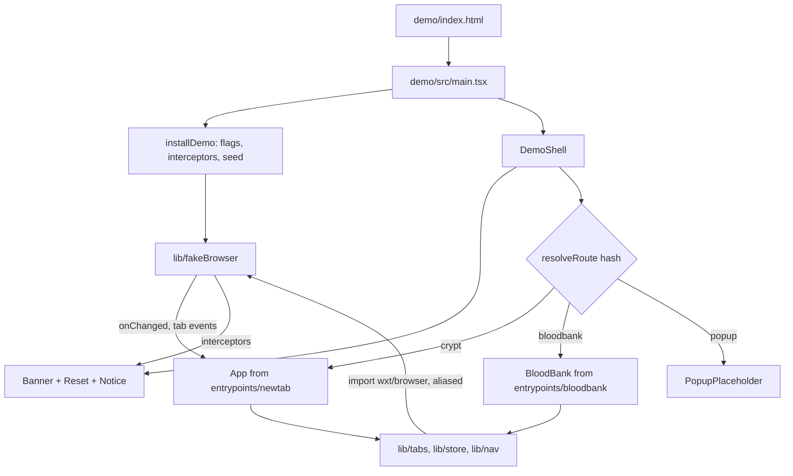

# Design: Web demo (Spec 7)

## Overview

The demo is a second Vite build in `demo/`. It renders the real Crypt page and the real Blood Bank page in an ordinary browser tab. The extension code runs unchanged on top of a fake `browser` that lives in memory and is seeded with about 20 sample tabs. It deploys to GitHub Pages from a GitHub Actions workflow.

Four changes to existing code make this possible without copying components:

1. **Shared fake.** `tests/helpers/fakeBrowser.ts` moves to `lib/fakeBrowser.ts`. The old path becomes a one-line re-export, so no existing test changes.
2. **Blood Bank component.** The page body moves from `entrypoints/bloodbank/main.tsx` to an exported `BloodBank` component. `main.tsx` keeps only the mount code.
3. **Base-aware model paths.** A new `lib/assetUrl.ts` replaces every hard-coded `/models/...` string.
4. **Two capability flags.** A new `lib/capabilities.ts` lets the demo switch off remote suggestions and remote icons. The defaults keep the extension as it is.

Decisions and reasons:

| Decision | Reason |
| --- | --- |
| Alias `wxt/browser` to the fake in the demo's Vite config. | Extension pages and `lib/` stay untouched. The same fake runs the tests and the demo, so the demo cannot drift from what the tests prove. |
| Hash routing, written by hand (about 30 lines). | GitHub Pages has no server rewrites. Three routes do not need a router library. |
| Capability flags instead of `if (demo)`. | Req 1.6 forbids demo branches in extension code. A flag with an extension-safe default is a setting, not a branch on the build. |
| Interceptors in the fake for navigation and search. | The pages call `tabs.update({ url })` and `search.query`. The fake can turn those into notices without the pages knowing. |
| Tab icons are `data:image/svg+xml` URIs. | `SiteIcon` accepts only `http(s):` and `data:image/` addresses. A data URI makes no request and needs no extra file. |
| `assetUrl` reads `import.meta.env.BASE_URL` only, never `browser.runtime.getURL`. | The extension output stays `/models/...`, so `tests/layout.test.ts` keeps passing. Decided with the user. |
| The page frame fills its container (flex column, `min-height: 0`) instead of using an inner `100vh`. | The Crypt then fits with or without the banner strip, and the extension keeps its no-scroll guarantee. |

No new runtime dependencies. No tab data leaves the page.

## Architecture



Startup order in `demo/src/main.tsx`: set capabilities, install interceptors, seed the fake, set `currentTabId`, then render. Pages never run before the seed.

### Build

`demo/vite.config.ts`:

```ts
export default defineConfig({
  root: 'demo',
  base: './',                       // relative: works at /<repo>/ and at /
  publicDir: '../public',           // copies public/models to demo/dist/models
  plugins: [react(), noRemoteDraco],
  resolve: { alias: { 'wxt/browser': resolve(__dirname, '../lib/fakeBrowser.ts') } },
  build: { outDir: 'dist', emptyOutDir: true },
});
```

- `noRemoteDraco` moves from `wxt.config.ts` to `build/noRemoteDraco.ts`, and both configs import it. The extension build output is unchanged.
- `@vitejs/plugin-react` is a dev dependency of the demo only (`@wxt-dev/module-react` is WXT-specific). Version to be pinned when the task runs.
- Scripts: `"demo:dev": "vite --config demo/vite.config.ts"`, `"demo:build": "vite build --config demo/vite.config.ts"`.
- `tsconfig.json` must cover `demo/`. If the generated `.wxt/tsconfig.json` include list does not already reach it, add `demo` to `include` in the root file. `demo/env.d.ts` references `vite/client`.
- Fonts come from `@fontsource` CSS, which Vite bundles. Nothing loads from a CDN.

### Styles and mounting

`entrypoints/newtab/main.tsx` imports about a dozen CSS files. They move into `entrypoints/newtab/styles.ts` (side-effect imports only), which `main.tsx` and the demo both import. `BloodBank.tsx` imports its own CSS.

**Frame layout (changed CSS in the extension).** Today `base.css` gives `html, body, #root` and `.page` each `height: 100vh`, and `bloodbank.css` overrides `html, body, #root` to scroll. Loaded together in the demo, the second rule would break the Crypt, and the inner `100vh` would overflow under the banner. The fix:

```css
/* base.css */
html, body, #root { height: 100vh; overflow: hidden; }   /* the root fills the viewport: the only 100vh left */
#root { display: flex; flex-direction: column; }
.page { flex: 1 1 0; min-height: 0; display: flex; flex-direction: column; overflow: hidden; }   /* fills the root */
```

```css
/* bloodbank.css: the html/body/#root override is removed; the page scrolls inside its own container */
.bb-scroll { flex: 1 1 0; min-height: 0; overflow: auto; }
```

`BloodBank` renders `<div className="bb-scroll"><main className="bb">...</main></div>`. In the extension, `#root` is a flex column of viewport height, so `.bb-scroll` scrolls and the document itself never does. This is the same on screen as before.

In the demo, the shell is the `#root` content:

```css
.demo-strip { flex: 0 0 auto; }
.demo-frame { flex: 1 1 0; min-height: 0; display: flex; flex-direction: column; position: relative; overflow: hidden; }
```

The page mounts inside `.demo-frame`. `.page` and `.bb-scroll` are flex children that fill it, so the banner never pushes the page past the viewport, and no `--demo-strip-h` value is needed. Every Blood Bank selector stays prefixed `bb-`.

## Components and Interfaces

### File changes

```
lib/fakeBrowser.ts              moved from tests/helpers; adds clearData, interceptors, autoEvents, extensionBase
lib/assetUrl.ts                 new: assetUrl(path)
lib/capabilities.ts             new: { remoteSuggestions, remoteIcons }
lib/scene/layout.ts             models addresses go through assetUrl
entrypoints/newtab/layers/...   Vampire, Coffin, OpenCoffin, FarVillage, Skeletons, Props: assetUrl
entrypoints/newtab/Haunts.tsx   faviconSources honours capabilities.remoteIcons
entrypoints/newtab/hooks/useSuggestions.ts   skips the web request when remoteSuggestions is false
entrypoints/newtab/styles.ts    new: fonts and CSS imports shared by main.tsx and the demo
entrypoints/newtab/main.tsx     imports styles.ts
entrypoints/newtab/styles/base.css   #root flex column, .page fills the root (no inner 100vh)
entrypoints/bloodbank/bloodbank.css  global html/body/#root override replaced by .bb-scroll
tests/css.test.ts               layout guarantee rewritten (see Testing)
entrypoints/bloodbank/BloodBank.tsx   new: exported BloodBank (moved code)
entrypoints/bloodbank/main.tsx  thin mount
build/noRemoteDraco.ts          moved from wxt.config.ts
wxt.config.ts                   imports the plugin
demo/                           new: vite.config.ts, index.html, env.d.ts, src/*
tests/helpers/fakeBrowser.ts    becomes: export * from '../../lib/fakeBrowser'
tests/demo/*                    new
.github/workflows/pages.yml     new
package.json                    + demo:dev, demo:build, plugin-react
```

### `lib/assetUrl.ts` and asset paths

```ts
/** Address of a file in public/, valid in the extension, the dev server and a sub-path deploy. */
export function assetUrl(path: string): string {
  const base = import.meta.env.BASE_URL || '/';   // '/' in the extension and tests, './' in the demo
  return base + path.replace(/^\/+/, '');
}
```

`BASE_URL` is read at call time, so tests can stub it with `vi.stubEnv`. Every string `'/models/...'` becomes `assetUrl('models/...')`: `VAMPIRE_URL`, `COFFIN_URL`, the `useGLTF.preload` calls (they run at import, after the entry has set nothing, which is fine because `BASE_URL` is a build constant), `OpenCoffin`, `FarVillage`, `Skeletons`, `Props` and `modelUrl` in `lib/scene/layout.ts`. `tests/network.test.ts` and `gltfCallsWithDraco` keep working because they check the `false` Draco argument, not the path.

`assetUrl` returns the same string as before in the extension and tests (`BASE_URL` is `/`), and does not call `browser.runtime.getURL`. This keeps `tests/layout.test.ts` passing.

In the demo, `./models/x.glb` resolves against the page address. Hash routes do not change the path, so it works at any sub-path.

### `lib/capabilities.ts`

```ts
export const capabilities = { remoteSuggestions: true, remoteIcons: true };
```

- `useSuggestions`: the web effect returns early when `!capabilities.remoteSuggestions`. `fetchGoogleSuggestions` is never called, so the typed text goes nowhere (Req 8.2).
- `faviconSources(pageUrl, opts)`: when `!capabilities.remoteIcons`, only the tab icon (if it passes `SAFE_ICON_URL`) is returned. The Chrome cache, `/favicon.ico` and DuckDuckGo entries are skipped, and the existing letter fallback shows (Req 8.4). `HauntIcon` is unchanged.
- The demo sets both to `false` before mounting. Extension pages never touch the object.

### `lib/fakeBrowser.ts`

The module keeps its current exports (`fake`, `browser`, `events`, `fire`, `FakeTab`), so every existing test works through the re-export. Additions:

```ts
interface FakeTab { /* existing */ favIconUrl?: string; }
type Intercept = (op: { kind: 'update' | 'create'; tabId?: number; props: { url?: string; active?: boolean } }) => boolean;
fake.intercept?: Intercept;              // return true: handled, the fake changes nothing
fake.onSearch?: (info: { text: string }) => void;
fake.autoEvents = false;                 // demo sets true
fake.extensionBase = 'chrome-extension://fake-id/';   // demo: 'tabpire-demo://app/'
fake.clearData(): void;                  // tabs, storage, log, searches, alarms, badge, nextId. Keeps listeners and switches.
fake.reset(): void;                      // clearData + listeners + switches + interceptors (unchanged meaning for tests)
```

Why `clearData` exists: `reset()` removes listeners, so the demo cannot use it. A demo reset would unsubscribe the mounted page. `clearData` keeps them.

Behaviour:

| API | Behaviour |
| --- | --- |
| `tabs.*` | As today. With `autoEvents`, `remove` fires `onRemoved(id, info)`, `discard` fires `onUpdated(id, { discarded: true }, tab)`, `create` fires `onCreated(tab)`, `update` fires `onUpdated`. |
| `tabs.update`, `tabs.create` | Before changing anything, call `fake.intercept` if set. A `true` result skips the change. The call log entry is still written. |
| `storage.local.set` | As today: writes, then calls every `onChanged` listener with `{ key: { newValue } }, 'local'`. It also adds `oldValue`. |
| `search.query` | Records the search, calls `fake.onSearch`. No network. |
| `runtime.getURL(path)` | `fake.extensionBase + path` without a leading slash. `useCrypt` passes `getURL('')` to `buildCards` to hide Tabpire's own pages, so the Crypt tab's URL is `getURL('newtab.html')` and it never shows as a card. |
| `alarms`, `action`, `windows.update` | As today. The demo has no background script, so nothing reads the badge. |
| `tabs.getCurrent` | Returns `currentTabId`. The demo sets it to the Crypt tab. |

The fake never touches `localStorage`, `sessionStorage`, IndexedDB or cookies. It is plain objects and arrays. The one documented exception to the no-`localStorage` rule is the Sky_Cache of the themes spec (`lib/themeCache.ts`, one Theme_Id in `localStorage`, outside the Fake_Browser).

### Router: `demo/src/route.ts`

```ts
export type Route = 'crypt' | 'bloodbank' | 'popup';
export function resolveRoute(hash: string): Route | null {
  // '#/crypt' | '#/bloodbank' | '#/popup' (a trailing slash or a query part is tolerated) else null
}
export function useRoute(): Route;        // listens to hashchange, redirects null to #/crypt with location.replace
```

`useRoute` calls `history.replaceState` (not `location.hash =`) for the redirect, so the back button does not loop. A route change renders another component. It does not reload, and the fake lives at module level, so state survives.

### Shell: `demo/src/DemoShell.tsx`

```tsx
<div className="demo-strip">
  <Banner>Demo: sample tabs, nothing leaves your browser. Install the extension for real tabs.</Banner>
  <button onClick={reset}>Reset demo</button>
  <nav> Crypt · Blood Bank · Popup </nav>
  <DemoNotice />                          {/* aria-live="polite", auto-hides after 4 s */}
</div>
<div className="demo-frame" key={`${route}-${epoch}`}>{page}</div>
```

- The strip is a normal block above the frame. It overlays nothing, so the header, cards and search box stay fully usable (Req 7.2).
- `reset()` calls `fake.clearData()`, then `seedDemo(Date.now())`, then bumps `epoch`. The new `key` remounts the page, which drops React state such as toasts and filters. The hash is untouched, so the route stays (Req 7.4).
- `DemoNotice` subscribes to a tiny event emitter (`demo/src/notice.ts`) that the interceptors write to.

### Interceptors: `demo/src/intercept.ts`

`fake.intercept` receives each `tabs.update` or `tabs.create` and decides:

| Call | Result |
| --- | --- |
| URL starts with `extensionBase + 'newtab.html'` | Set the hash to `#/crypt`. Handled. |
| URL starts with `extensionBase + 'bloodbank.html'` | Set the hash to `#/bloodbank`. Handled. |
| `update` with another URL (card title click, haunt, crypt link) | Notice: "In the extension this opens `<host>`." Handled. |
| `update({ active: true })` on a tab (the `showTab` path) | Notice: "In the extension this switches to `<title>`." Handled. |
| `create` with a web URL | Not intercepted. Resurrect needs a real new fake tab (Req 5.5). |

`fake.onSearch` raises the notice `Searched for "<text>" (the extension uses your default search engine).` The page never leaves.

Interception happens at the `browser` boundary, so `lib/nav.ts` and `lib/tabs.ts` are not edited.

### Pages

- Crypt: `<App />` from `entrypoints/newtab/App`, same component as `main.tsx`.
- Blood Bank: `<BloodBank />` from `entrypoints/bloodbank/BloodBank`. "Back to The Crypt" calls `openCrypt({ sameTab: true })`, which reaches the interceptor and sets `#/crypt`.
- Popup: `PopupPlaceholder`, a 360 by 520 frame centred in the page: "The popup is not built yet." Spec 6 swaps this one component for the real popup.

WebGL needs nothing new. `App` already uses `detectWebgl` and `useWebgl`, so a browser without WebGL shows the flat fallback, and context loss follows the existing handlers (Req 9.4 to 9.7). Blood Bank and the placeholder create no canvas (Req 9.8).

### Seed: `demo/src/seed.ts`

```ts
export function seedDemo(now: number): void
```

It is a pure function of `now` plus the fake, and takes `now` as a parameter. It does not read the clock itself and uses no fixed or build-time timestamp. `demo/src/main.tsx` passes `Date.now()` read at startup, the Reset handler passes `Date.now()` read when Reset is pressed, and tests pass chosen values.

Every dated value is an offset from `now`: `lastAccessed = now - idleMs`, crypt `savedAt = now - offset`, log `at = now - offset`. The demo therefore looks the same whenever a judge opens it. Idle offsets (hours or days) keep a margin of at least 2 hours from the one-day line, so a test run that takes a few seconds or minutes does not change any classification:

| Group | Count | Idle |
| --- | --- | --- |
| Crypt tab (active, own page) | 1 | 0 |
| Awake | 6 | 1 min to 5 h |
| Audible (`audible: true`) | 1 | 2 min |
| Starving (closed by Dawn) | 8 | 1.2 to 4.6 days |
| Starving and pinned (Dawn spares it) | 1 | 2 days |
| Garlic site (protected) | 2 | 1.5 and 3 days |
| Discarded (`discarded: true`, state Asleep whatever its idle time) | 1 | 6 days |
| **Total** | **20** | |

The closest offsets to the one-day line are 5 hours (awake, 19 hours below) and 1.2 days (starving, 4.8 hours above), both beyond the 2-hour margin.

Titles and URLs are realistic `https` pages on sites already in `KNOWN_SITE_MB` (YouTube, GitHub, Figma, Gmail, ChatGPT, Claude and others), so the memory estimates look right. `favIconUrl` is a `data:image/svg+xml` URI built by `letterIcon(site)`: a coloured rounded square with the first letter.

Stored data written through `browser.storage.local.set` with the keys from `KEYS`:

| Data | Seed |
| --- | --- |
| garlic | 2 sites, both with an open tab |
| haunts | 4 (`MAX_HAUNTS` is 10) |
| crypt | 3 entries, `savedAt` 1 to 3 days before `now` |
| stats | staked 12, coffined 5, crypted 9, dawns 2, `mbFreed` about 3400 |
| log | 8 entries, `at` spread over the last 3 days, newest last |

`seedDemo` ends by setting `fake.currentTabId` to the Crypt tab and `fake.autoEvents = true`.

## Data Models

No new stored types. The seed fills the existing `Stats`, `LogEntry`, `CryptEntry`, `Haunt` and garlic `string[]` shapes from `lib/store.ts`, so the store's own validators accept it.

```ts
interface DemoNotice { id: number; text: string }      // demo/src/notice.ts, memory only
type Route = 'crypt' | 'bloodbank' | 'popup';
```

## How every action is exercised

All actions run through the real `lib/tabs.ts` against the fake.

| Action | Path in the demo |
| --- | --- |
| Stake | `tabs.remove`, stats and log written, `onChanged` fires, `useCrypt` reloads, card exits. |
| Coffin | `tabs.discard`. The card turns Asleep. |
| Crypt | Crypt entry written, tab removed. Blood Bank lists it. |
| Garlic | Garlic list written. Cards of that site turn Protected. |
| Resurrect | `tabs.create` makes a new fake tab (not intercepted). The entry leaves the crypt. |
| Dawn | Targets saved, then removed. The active, pinned, audible and garlic tabs stay. |
| Search | `search.query` records it. The notice shows the text. |
| Add page | Haunt written to storage. The row updates. |
| Blood Bank | Hash changes. Stats and log are read from the same fake. |

`useCrypt` refreshes on `storage.onChanged` (every action writes stats or the log), so card and stats updates need no tab events. `autoEvents` fires them anyway for fidelity (Req 3.4).

## Network and navigation

| Source | Handling |
| --- | --- |
| Search suggestions | `capabilities.remoteSuggestions = false`. Local suggestions only. |
| Tab icons | Seeded `data:` URIs. |
| Haunt icons | `capabilities.remoteIcons = false`. Tab icon if an open tab shares the site, else the letter. |
| `/_favicon/` | Not requested. `faviconSources` skips it under the flag. |
| Fonts, models, styles | Bundled. `noRemoteDraco` keeps the drei decoder address out of the bundle. |
| Link clicks, `tabs.update` | Interceptor notice. |

The built output is scanned for addresses (see Testing). If the scan finds a CDN address inside a library, it is either neutralised with a transform like `noRemoteDraco` (when the code would fetch it) or, when it is only a string that is never fetched, added to a short allowlist in the test. Library code is never stripped. Each allowlist entry carries a one-line comment giving the reason.

## GitHub Pages deploy

`.github/workflows/pages.yml`:

```yaml
name: Deploy demo
# One-time setup: Settings > Pages > Build and deployment > Source: "GitHub Actions".
on:
  push: { branches: [main] }
  workflow_dispatch:
permissions:
  contents: read
  pages: write
  id-token: write
concurrency: { group: pages, cancel-in-progress: true }
jobs:
  build:
    runs-on: ubuntu-latest
    steps:
      - uses: actions/checkout@v4
      - uses: actions/setup-node@v4
        with: { node-version: 22, cache: npm }
      - run: npm ci
      - run: npm run demo:build
      - run: npm test
      - uses: actions/upload-pages-artifact@v3
        with: { path: demo/dist }
  deploy:
    needs: build
    runs-on: ubuntu-latest
    environment: { name: github-pages, url: '${{ steps.deployment.outputs.page_url }}' }
    steps:
      - id: deployment
        uses: actions/deploy-pages@v4
```

`npm test` and the build both run in the `build` job, and `deploy` depends on it, so a failing test or build stops the deploy (Req 10.4). `npm ci` runs the `postinstall` script (`wxt prepare`), which the tests need. The built-output tests skip when `demo/dist` is missing, so the workflow runs `npm run demo:build` before `npm test`, and the scan then runs in CI. The default branch is assumed to be `main`.

## Correctness Properties

*A property is a characteristic or behavior that should hold true across all valid executions of a system-essentially, a formal statement about what the system should do. Properties serve as the bridge between human-readable specifications and machine-verifiable correctness guarantees.*

Redundant criteria were merged. The seed criteria (4.1 to 4.9, 8.3) merge into one property. The two base-path criteria (1.4, 9.2) merge into one. The four Dawn safety criteria (6.1 to 6.4) and 6.6 merge into one. Action examples (5.1 to 5.9) are example tests, because the library behaviour is already covered by Spec 2.

### Property 1: Route resolution

For any hash string, `resolveRoute` returns `crypt`, `bloodbank` or `popup` for the three exact route hashes (with an optional trailing slash), and `null` for every other string, and the shell renders the Crypt for `null`.

**Validates: Requirements 2.1, 2.2, 2.3, 2.4**

### Property 2: Asset addresses resolve under the base

For any base in `/`, `./`, `/repo/` and any model path with or without a leading slash, `assetUrl(path)` starts with the base, contains no doubled slash after it, and resolved against a document at that base's location it points to `<base>models/...` and never above it.

**Validates: Requirements 1.4, 9.2**

### Property 3: Storage events and round trip

For any sequence of `storage.local.set` calls, every call fires `onChanged` with the new value for each key it set, and `get` returns the last value written for every key.

**Validates: Requirements 3.3**

### Property 4: Tab events match tab changes

For any sequence of `create`, `remove`, `discard` and `update` calls on the fake with automatic events on, each successful call fires exactly the matching event once, a failed call fires none, and the final tab map equals a simple model applying the same calls.

**Validates: Requirements 3.4**

### Property 5: Intercepted navigation changes nothing

For any URL passed to `tabs.update` while the demo interceptor is installed, no tab's `url` changes, no tab leaves the map, and one notice is raised, except for the two own-page URLs, which change only the hash.

**Validates: Requirements 5.10**

### Property 6: Seed data is well formed

For any `now`, `seedDemo(now)` creates 18 to 22 tabs with https URLs (the Crypt tab excepted), with exactly one audible tab, exactly one discarded tab, at least one pinned tab, exactly one active tab, at least 5 awake tabs, at least 5 starving tabs idle between 1 and 5 days, and at least one tab on a garlic site. It stores 2 or more garlic sites, 3 to 6 haunts (at most `MAX_HAUNTS`), 2 to 5 crypt entries, and a non-empty log. Every tab gets exactly one `stateOf` result, the counts of the states match, and every `lastAccessed` equals `now` minus a non-negative idle time. Every `favIconUrl` starts with `data:image/`.

**Validates: Requirements 4.1, 4.2, 4.3, 4.4, 4.5, 4.6, 4.7, 4.8, 4.9, 8.3**

### Property 7: Dawn spares protected tabs

For any generated set of tabs and garlic list loaded into the fake, after `dawn(now)` every active, pinned, audible and garlic-site tab is still open.

**Validates: Requirements 6.1, 6.2, 6.3, 6.4, 6.6**

### Property 8: Dawn closes the other starving tabs, saved first

For any generated set of tabs and garlic list, after `dawn(now)` the closed tabs are exactly `dawnTargets`, each closed tab's URL is in the crypt, and in the call log every `set:tabpire:crypt` entry comes before the first `remove`.

**Validates: Requirements 6.5**

### Property 9: Action sequences keep the invariants

For any sequence of Stake, Coffin, Crypt, Garlic, Resurrect and Dawn actions on a seeded fake, `stats.mbFreed` never decreases between steps, and the crypt never holds two entries with the same URL.

**Validates: Requirements 6.7**

### Property 10: Reset restores the sample data

For any sequence of actions followed by a reset at time `t`, the fake's tabs (ignoring ids), storage values, garlic list, haunts and crypt equal those of a fresh `seedDemo(t)`, and resetting twice gives the same result as resetting once.

**Validates: Requirements 7.3**

### Property 11: No remote suggestions

For any typed text of 2 or more characters, with `remoteSuggestions` off, `useSuggestions` makes no `fetch` call and does not call `fetchGoogleSuggestions`, and its list contains only local suggestions and the web-search row.

**Validates: Requirements 8.2**

### Property 12: No remote icons

For any page URL and any optional tab icon, with `remoteIcons` off, `faviconSources` returns either an empty list or only the tab icon, and never an `http(s)` address that was not given as the tab icon.

**Validates: Requirements 8.4**

## Error Handling

| Case | Behaviour |
| --- | --- |
| Hash is empty or unknown | Redirect with `replaceState` to `#/crypt`. |
| Model file fails to load | Existing `LayerBoundary` error state. The cards and actions keep working. |
| WebGL missing or context lost | Existing fallback and restore handling. |
| A page throws while rendering | The shell wraps each page in an error boundary showing "This demo page failed. Reset the demo." with the Reset button still in the strip. |
| An action fails in the fake | The page shows its normal failure toast. The fake offers the same failure switches as in the tests, but the demo never sets them. |
| Interceptor receives an unknown URL scheme | Treated as an outside link: notice only, nothing changes. |
| Storage listener throws | The fake catches per listener and keeps notifying the rest (matches how the real API isolates listeners). |
| Reset during an in-flight action | `clearData` runs, then the page remounts. A late write from the old page can land in the new data, so Reset waits one `await Promise.resolve()` tick after `clearData` and seeds after it. |

## Testing Strategy

Property-based testing applies to the pure logic: the route parser, `assetUrl`, the fake's event rules, the seed, Dawn's safety, the action invariants, reset and the two capability gates. It does not apply to the Vite and workflow configuration, layout or the 3D scene. Those use smoke, example and manual checks.

**Library:** fast-check (already installed). Each property is one test with at least 100 runs. Each test carries a comment tag: `Feature: web-demo, Property N: <text>`.

### Property tests (`tests/demo/`, `tests/fakeBrowser.test.ts`)

| File | Properties |
| --- | --- |
| `tests/demo/route.test.ts` | 1 |
| `tests/assetUrl.test.ts` | 2 |
| `tests/fakeBrowser.test.ts` | 3, 4 |
| `tests/demo/intercept.test.ts` | 5 |
| `tests/demo/seed.test.ts` | 6, 10, plus the two-`now` check below |
| `tests/demo/dawn.test.ts` | 7, 8, 9 (real `lib/tabs.ts` on the fake via `vi.mock('wxt/browser')`) |
| `tests/demo/network.test.ts` | 11, 12 |

Generators: tab sets with random `id`, `url` (https and non-web), `active`, `audible`, `discarded`, `pinned` and `lastAccessed` around the one-day line, plus a garlic list drawn from the generated sites, so garlic collisions happen. Action sequences draw from a list of actions with a tab index or entry index, resolved against the current state.

### Unit and example tests

- **Seed is relative to `now`** (`tests/demo/seed.test.ts`): `seedDemo` runs at two different `now` values (for example `0` and a value 10 years later). Both runs give the same `stateOf` classification counts and the same relative idle times (`now - lastAccessed`), and the same relative `savedAt` and `at` offsets. A Reset test with a fake clock moved forward shows the recomputed ages use the time of the Reset, not the load time.

- **Fake browser** (`tests/fakeBrowser.test.ts`): `tabs` (`get`, `getCurrent`, `query`, `update`, `remove`, `discard`, `create`), `alarms.create` replaces by name, `search.query` records and never calls `fetch`, `runtime.getURL`, `clearData` keeps listeners, `reset` removes them. A spy on `Storage.prototype`, `indexedDB` and `document.cookie` shows no use (Req 3.2).
- **Route mounts** (`tests/demo/routes.test.tsx`, jsdom): each of the three routes shows the banner text and its landmark (`main` for Crypt and Blood Bank, the placeholder text for the popup). Changing the hash switches pages and leaves the fake state intact. Blood Bank and the placeholder never call `canvas.getContext`.
- **Actions** (`tests/demo/actions.test.tsx`, jsdom): on the seeded demo, Stake, Coffin, Crypt, Garlic, Resurrect and Dawn each give the result in Req 5.1 to 5.6. Search shows the notice and calls `search.query`. Add page adds a haunt. Blood Bank shows the earlier stats and log. A card link shows a notice and keeps the hash.
- **Reset**: after Stake and Dawn, Reset restores the seeded card count and stats, and keeps the route (Req 11.4, 7.4).
- **Existing tests**: all run unchanged through the re-export (Req 11.2). `tests/layout.test.ts` confirms `assetUrl` leaves the extension paths as they were.
- **Blood Bank move**: `main.tsx` is checked to import `BloodBank` and nothing else of the page body. A render test checks the same headings as before.
- **Workflow** (`tests/demo/workflow.test.ts`): the YAML text has `push`, `workflow_dispatch`, exactly the three permissions, test and `demo:build` steps before `upload-pages-artifact`, and a comment naming the "GitHub Actions" source.
- **CSS layout** (`tests/css.test.ts`): the old test asserted `html, body, #root` have `height: 100vh` and `overflow: hidden`. It keeps that and adds: `#root` is `display: flex` with `flex-direction: column`; `.page` has `flex: 1 1 0`, `min-height: 0` and no `height: 100vh`; no rule in the extension styles other than `html, body, #root` uses `100vh`. A second test reads `bloodbank.css`: it has no `html`, `body` or `#root` selector, and `.bb-scroll` has `overflow: auto` and `min-height: 0`.
- **Typecheck**: `npm run typecheck` passes with `demo/` included (Req 11.6).

### Built-output tests (`tests/demo/built.test.ts`, skipped when `demo/dist` is absent)

- Every `.html`, `.js` and `.css` file is scanned for `https?://` addresses. Allowed: namespace URIs (`http://www.w3.org/`), the project's own repository links, and a short list of third-party strings that are never fetched, each with a one-line reason in the test. Any other address fails the test (Req 8.7, 8.1, 8.5).
- No built file mentions `gstatic.com` or `suggestqueries.google.com`.
- `index.html` has no root-absolute `src` or `href` (it would break under `/<repo>/`).
- `demo/dist/models` has every file under `public/models`.

### Manual check (Playwright MCP, after deploy)

Open the deployed address and confirm: each action, search, Add page, Blood Bank and Reset work. Open the network panel and confirm all requests go to the page's own origin. Check once with WebGL on and once with it off. Check that the Crypt and Blood Bank fit under the banner strip (the layout itself is covered by tests). Record the result in the tasks (Req 11.5).

## Open points

Seed times are always relative to the `now` passed in (startup and each Reset), so there is no staleness issue to track.

Resolved with the user:

- `assetUrl` uses `import.meta.env.BASE_URL` only. No `browser.runtime.getURL`.
- The default branch is `main`.
- Third-party URL strings that are never fetched are allowlisted in the built-output test, each with a reason. Library code is not stripped.
- The frame layout is fixed in CSS now (flex column, `min-height: 0`), not left to a manual check.
