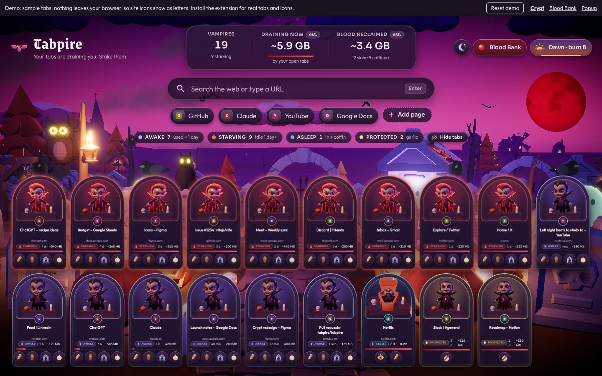
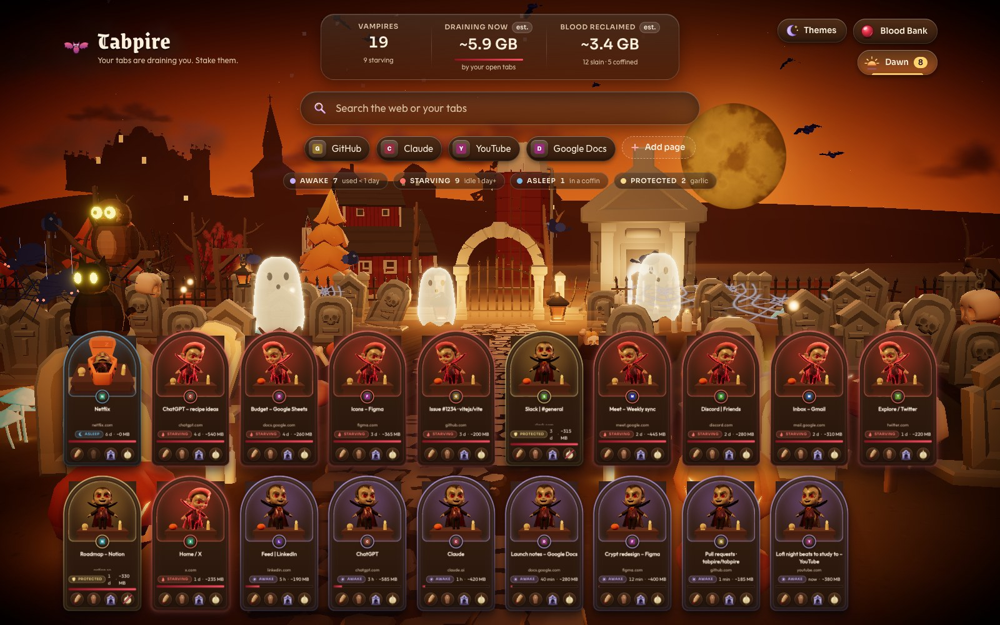

<div align="center">

# 🧛 Tabpire

**Your tabs are draining you. Stake them.**

A Chrome and Firefox new tab page where every open tab is a vampire, living in a 3D graveyard.
The longer you ignore a tab, the hungrier it gets.

### 🔗 Live demo: https://tejaswip08.github.io/kiroween-tabpire/

No install needed. [Install for judges](#install-for-judges) · [Install from source](#install-from-source) · [How it works](#how-it-works) · [How Kiro was used](#how-kiro-was-used)



</div>

## How it works

Every open tab is a vampire in exactly one state:

| State | When | What you see |
| --- | --- | --- |
| **Awake** | in use, playing sound, or used in the last day | a calm vampire that follows your cursor |
| **Starving** | not used for a day or more | a hunched, pacing vampire with a red glow |
| **Asleep** | put to sleep (discarded) to free memory | it sleeps in its coffin |
| **Protected** | its site is on your garlic list | it leans back, trembling |

Each card shows the site, idle time, estimated memory (always marked `~`, since browsers don't give
per-tab memory to extensions) and a hunger bar that fills over one day. Then you deal with it:

| Action | What it does | What the vampire does |
| --- | --- | --- |
| 🗡️ **Stake** | Close the tab | topples backwards |
| ⚰️ **Coffin** | Put the tab to sleep to free memory | sinks into a rising coffin |
| 🏺 **Crypt** | Save the tab for later, then close it | turns into a bat |
| 🧄 **Garlic** | Protect every tab on that site | stays, but turns Protected and leans back |
| ☀️ **Dawn** | Close every starving tab at once, saving each to the Crypt first | burns to embers |

**Dawn is safe:** it never closes the active tab, pinned tabs, tabs playing sound, or garlic sites.
Property-based tests check this against more than a thousand random tab sets.

Saved tabs come back with **Resurrect** from the search box, which suggests your open tabs, pinned
pages and the Crypt before web results, or from the **Blood Bank**. A sleeping tab has **Wake**. The toolbar
badge shows how many tabs are starving and refreshes every minute, and the toolbar **popup** shows the
starving count with a Dawn button. Every button and state chip has a tip in the vampire's own voice.

<table>
  <tr>
    <td width="50%"></td>
    <td width="50%"></td>
  </tr>
  <tr>
    <td align="center">Hover a card: the vampire tells you how long it has waited</td>
    <td align="center">The <b>Blood Bank</b>: memory reclaimed, counts, your hunter rank and recent deeds</td>
  </tr>
</table>

## Four themes
Each theme has its own sky, moon, fog and lights, its own props and its own weather. Your choice is saved and
used on every Tabpire page.
<table>
  <tr>
    <td width="50%"><br><b>The Crypt</b>: purple night, a red moon and a quiet graveyard</td>
    <td width="50%"><br><b>Pumpkin Patch</b>: orange dusk, a barn, corn and falling leaves</td>
  </tr>
  <tr>
    <td><br><b>Witch's Forest</b>: green mist, twisted trees and fireflies</td>
    <td><br><b>Frozen Cemetery</b>: cold blue night, frosted pines and snow</td>
  </tr>
</table>
<p align="center"></p>
## Try it without installing

The [web demo](https://tejaswip08.github.io/kiroween-tabpire/) runs the real new tab page, Blood Bank and
popup in an ordinary browser tab, against an in-memory fake browser with about 20 sample tabs. Every action
and theme works, and nothing leaves your browser. **Reset demo** brings the sample tabs back.

## Install for judges

No build needed. This is for Chrome (or Edge, Brave, Arc).

1. Open the [latest release](https://github.com/tejaswip08/kiroween-tabpire/releases/latest) and download
   `tabpire-<version>-chrome.zip`.
2. Unzip it into a folder. Keep the folder; Chrome reads the files from it.
3. Open `chrome://extensions`.
4. Turn on **Developer mode** (top right).
5. Click **Load unpacked** and pick the unzipped folder (the one that contains `manifest.json`).
6. Open a new tab.

Firefox users can follow the build steps below.

## Install from source

You need Node.js 22.

```bash
npm install
npm run build            # Chrome: writes .output/chrome-mv3
npm run build:firefox    # Firefox: writes .output/firefox-mv3
```

**Chrome:** open `chrome://extensions`, turn on **Developer mode**, click **Load unpacked** and pick
`.output/chrome-mv3`. Open a new tab.

**Firefox:** open `about:debugging#/runtime/this-firefox`, click **Load Temporary Add-on** and pick
`.output/firefox-mv3/manifest.json`.

## Development

```bash
npm run dev              # opens Chrome with Tabpire loaded, with hot reload
npm run dev:firefox      # the same in Firefox
npm run typecheck
npm test                 # Vitest, including fast-check property tests
npm run demo:dev         # the web demo, in a normal browser tab
npm run demo:build       # builds the demo into demo/dist
npm run zip              # store upload zip for Chrome (.output/)
npm run zip:firefox      # store upload zip for Firefox (.output/)
```

Add `#fps` to the new tab address to show a small frame-rate readout.

The demo is deployed to GitHub Pages by `.github/workflows/pages.yml` on every push to `main`. The repository's
Pages setting must use the **GitHub Actions** source.

## Privacy

Tabpire is local-first: no account, no backend, no analytics. No data goes to any Tabpire server.
- **Settings sync through your browser account.** The theme, pinned pages and garlic list are kept in
  `browser.storage.sync`, so Chrome Sync or Firefox Sync carries them to your other devices. If sync is off or full,
  they stay on this device instead. Settings saved by an older version are copied to sync once on the first run.
- **Everything else stays on each device.** The crypt (saved tabs), the hunt log and the stats are in
  `browser.storage.local` and are never synced.

Two things use the network, as a browser does on its own, and neither involves a Tabpire server:

- **Search suggestions:** what you type in the search box is sent to Google's suggestion service.
- **Icons for pinned pages:** fetched from the site itself, or from DuckDuckGo's icon service if the site has none.

Permissions: `tabs`, `storage`, `alarms`, `search` and `favicon`, plus access to the suggestion service.

## Tech

- [WXT](https://wxt.dev) (Manifest V3), React 19 and strict TypeScript, for Chrome and Firefox
- three.js with React Three Fiber, drei and postprocessing: one background canvas for the graveyard, and one shared
  canvas for every card's vampire (drei `View`), built to run at 60 fps
- Plain CSS with design tokens per theme; CSS animations only change `transform` and `opacity`
- Vitest, Testing Library and fast-check
- Fonts: Grenze Gotisch, Sora and Outfit, bundled with Fontsource

## How Kiro was used

Tabpire was built for **Kiroween 2026** with [Kiro](https://kiro.dev), one spec at a time. Everything Kiro worked
from is in [`.kiro/`](.kiro).

### Specs
Each spec folder has `requirements.md`, `design.md` and `tasks.md`, and the work was done task by task.

| Spec | Covers |
| --- | --- |
| [`project-and-tab-rules`](.kiro/specs/project-and-tab-rules) | WXT project, tab states, hunger, memory estimates, storage |
| [`tab-actions-dawn-badge`](.kiro/specs/tab-actions-dawn-badge) | Stake, Coffin, Crypt, Garlic, Resurrect, Dawn, toolbar badge |
| [`crypt-page`](.kiro/specs/crypt-page) | The new tab page: header, cards, search, pinned pages |
| [`graveyard-3d`](.kiro/specs/graveyard-3d) | 3D graveyard, moon, sky life, the vampire on every card |
| [`themes`](.kiro/specs/themes) | The four enabled themes, their scenes and weather |
| [`popup-and-blood-bank`](.kiro/specs/popup-and-blood-bank) | Toolbar popup and Blood Bank page |
| [`web-demo`](.kiro/specs/web-demo) | The judges' demo against a fake `browser` |

### Steering
The files in [`.kiro/steering`](.kiro/steering) were loaded into every Kiro session:
[`product.md`](.kiro/steering/product.md) (states and actions),
[`style.md`](.kiro/steering/style.md) (look, fonts, animation limits),
[`tech.md`](.kiro/steering/tech.md) (stack, commands, performance rules),
[`structure.md`](.kiro/steering/structure.md) (folders and naming) and
[`roadmap.md`](.kiro/steering/roadmap.md) (the whole plan, so each spec fits the rest).

### Hooks
The hooks in [`.kiro/hooks`](.kiro/hooks) run when a file is saved:

- **Test on save:** `npm test` when a hunger file or a file under `tests/` is saved.
- **Typecheck on save:** `npm run typecheck` when a `.ts` or `.tsx` file is saved.
- **CSS animation check:** `node tools/check-css-animations.mjs` when a `.css` file is saved. It fails if a
  `@keyframes` block animates anything except `transform` and `opacity`.

### Property-based tests
The rules in `lib/` are pure, so they are tested with [fast-check](https://fast-check.dev) properties
(for example [`tests/hunger.test.ts`](tests/hunger.test.ts) and [`tests/dawn.test.ts`](tests/dawn.test.ts)):

- every tab has exactly one state;
- a memory estimate is stable for a tab, never negative, and rounded to 5 MB;
- hunger never goes down while a tab stays unused;
- Dawn never touches the active tab, pinned tabs, tabs playing sound, or garlic sites.

The scene layouts are also tested as pure data (inside the ground, no overlaps, clear of the moon and the cards).

### Pre-existing prototype
This repository did not start empty. I made a first prototype of Tabpire with another AI tool (Claude Code) on
2 November 2026, early in the Kiroween submission period (which started 30 October 2026), and then rebuilt it spec by
spec in Kiro. It was committed as `f464485` ("First Commit", 2 November 2026) and its history is kept in this
repository. It contained a first version of the hunger rules, storage, tab actions, search suggestions, Blood
Bank, popup, a 3D graveyard and its own early `.kiro` spec and steering files.

What is still related to it today: 16 source files sit at the same paths as in the prototype
(`lib/hunger.ts`, `lib/store.ts`, `lib/tabs.ts`, `lib/suggest.ts`, `entrypoints/background.ts`,
`entrypoints/newtab/Haunts.tsx`, the Blood Bank and popup entry files, `tests/hunger.test.ts`, `wxt.config.ts`).
Kiro rewrote them during specs 1 to 6, and none is unchanged, but they began as prototype code. The other
prototype source files were removed. Everything else (the Crypt page components, the 3D scenes, the four themes,
the web demo, the build tooling and the tests) was written in Kiro for Kiroween. The 3D models and the
vampire model are third-party or generated assets; see [Credits](#credits).

## Credits

- 3D models (CC0): [Graveyard Kit](https://kenney.nl/assets/graveyard-kit) by Kenney,
  [Halloween Bits](https://kaylousberg.itch.io/halloween-bits) by Kay Lousberg (KayKit), and models by
  [Quaternius](https://quaternius.com) from [Poly Pizza](https://poly.pizza). Licence files are in
  [`public/models`](public/models).
- The vampire: our own concept art generated with Meshy, turned into a 3D model with Tripo AI
  (free plan: public, non-commercial use).

## License

The code is [MIT](LICENSE). The Kenney, KayKit and Quaternius models are CC0. The vampire model is for
non-commercial use only.
