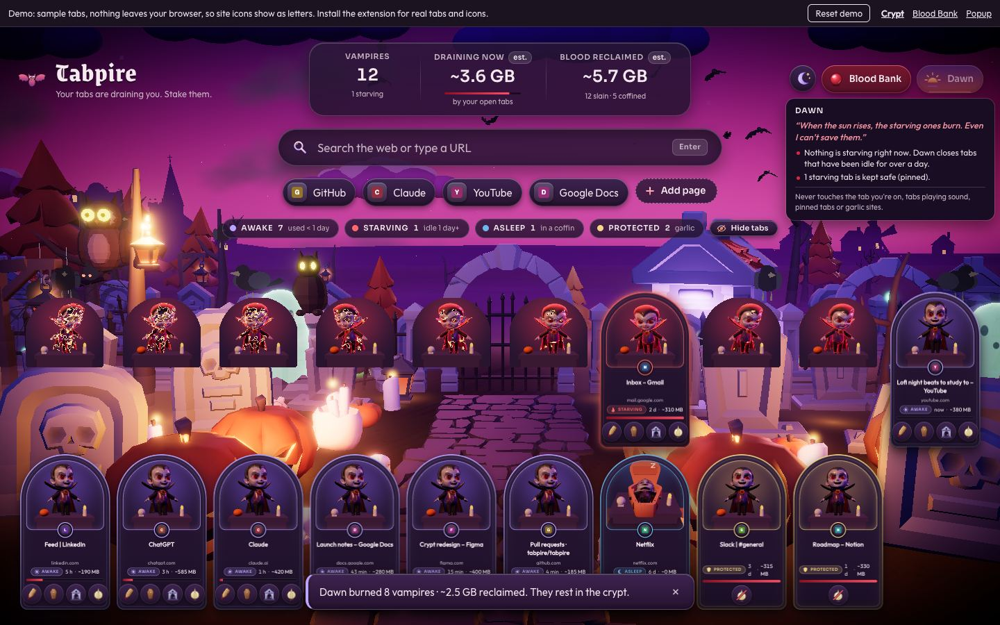
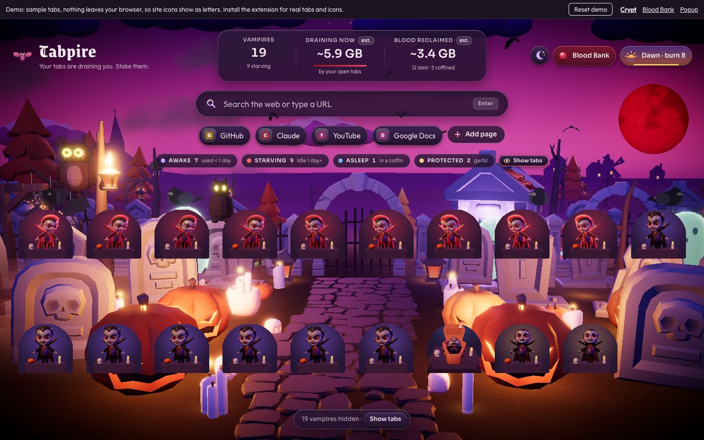
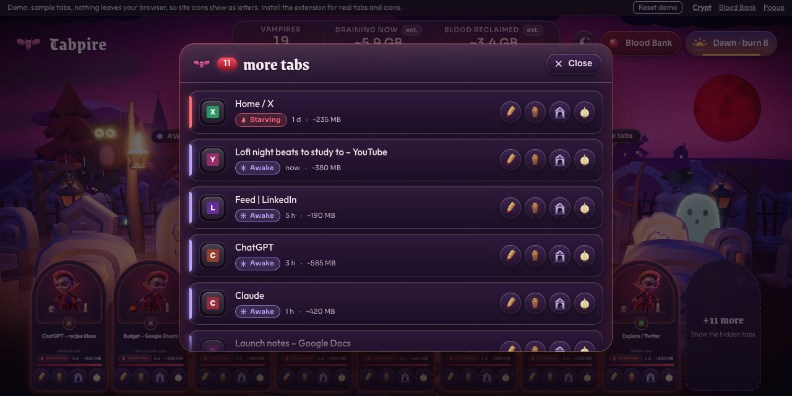
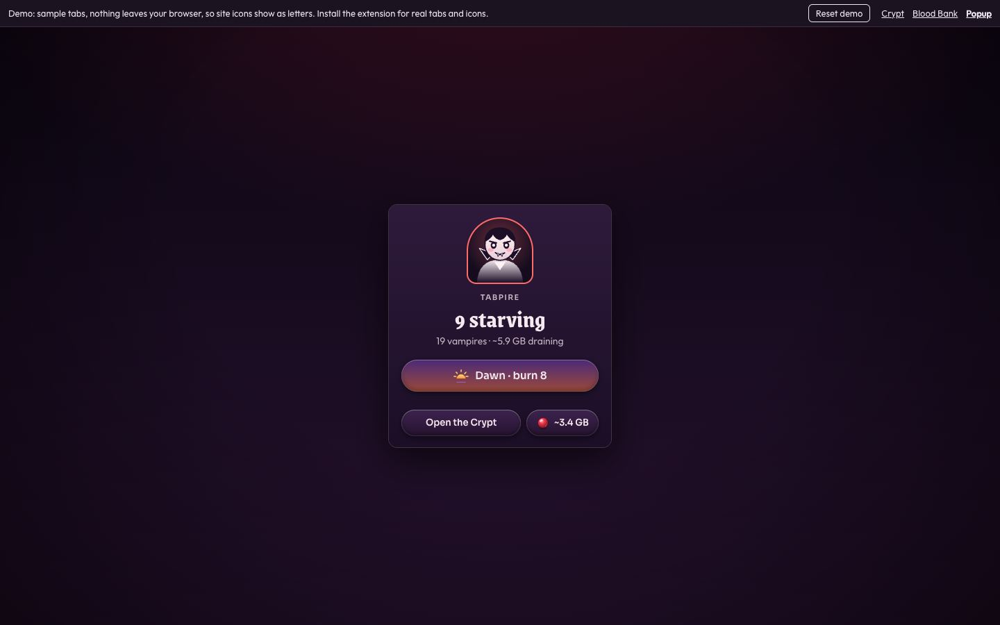
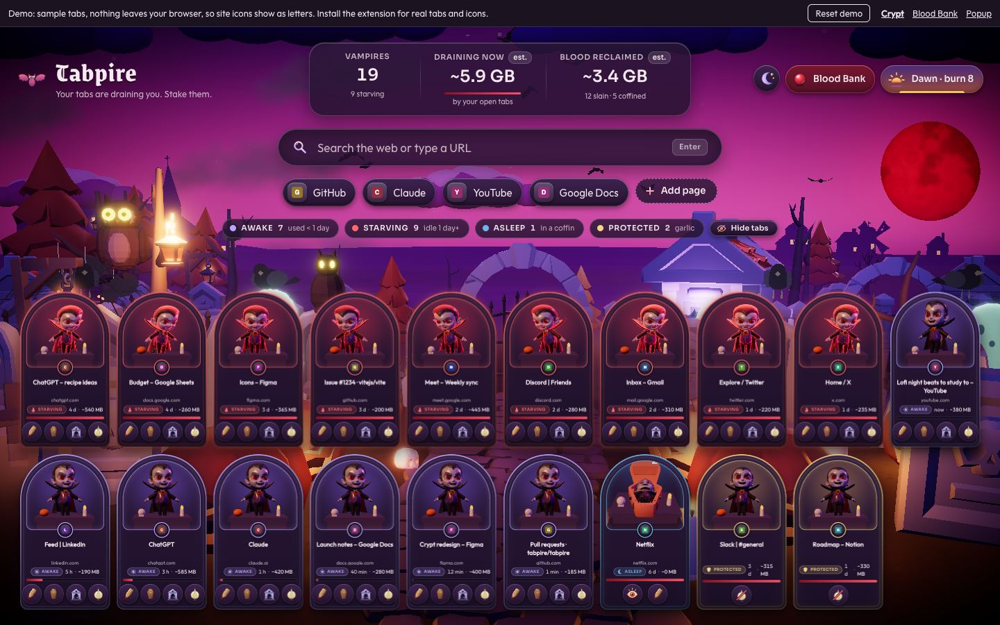
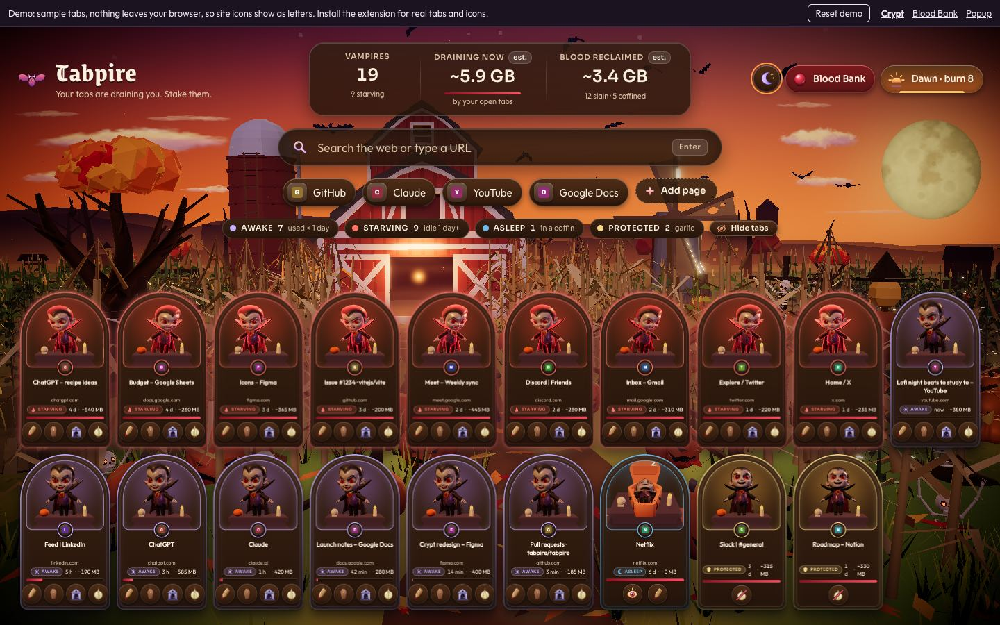
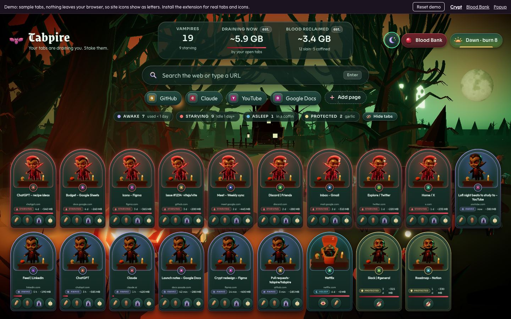
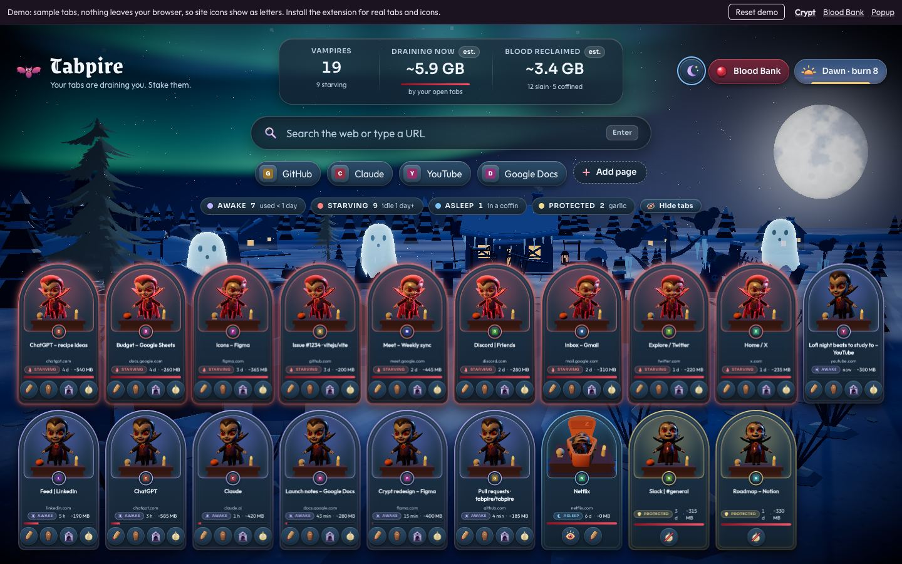

<div align="center">

# 🧛 Tabpire

**Your tabs are draining you. Stake them.**

A Chrome and Firefox new tab page where every open tab is a vampire in a 3D graveyard.

[](LICENSE)
[](https://kiro.dev)
[](https://kiroween.devpost.com)
[](#themes)

### [▶ Live demo (no install)](https://tejaswip08.github.io/kiroween-tabpire/) · [⬇ Download the extension](https://github.com/tejaswip08/kiroween-tabpire/releases/latest)

Video: coming soon


</div>

## Contents

- [The problem](#the-problem)
- [How it works](#how-it-works)
- [Actions](#actions)
- [Themes](#themes)
- [Try it without installing](#try-it-without-installing)
- [Install for judges](#install-for-judges)
- [Install from source](#install-from-source)
- [Privacy](#privacy)
- [Tech](#tech)
- [How Kiro was used](#how-kiro-was-used)
- [Pre-existing prototype](#pre-existing-prototype)
- [Credits](#credits) · [License](#license)

## The problem

Open tabs eat memory, and most people never close them. A tab opened "for later" sits for days, using hundreds of
megabytes, until the browser slows down. Tabpire is for anyone with too many tabs: it shows which ones you have
forgotten, how much they cost, and lets you close or save them in one click. Every spooky part means something: a
hungry vampire is a tab you have ignored.

## How it works

Every open tab is a vampire in exactly one state:

| State | When | What you see |
| --- | --- | --- |
| **Awake** | the active tab, playing sound, or used in the last day | a calm vampire that breathes and follows your cursor |
| **Starving** | not used for a day or more | a hunched, pacing vampire with a red glow |
| **Asleep** | discarded (in a coffin) to free memory | it sleeps in its coffin; the tab uses about 0 MB |
| **Protected** | its site is on your garlic list | it leans back, trembling |

Each card shows the site icon, title, state, idle time, **estimated** memory and a blood-vial **hunger meter** that
fills as the tab stays unused. Browsers don't tell extensions how much memory a tab uses, so Tabpire estimates it
from the site (for example chatgpt.com about 520 MB, claude.ai about 450 MB), with URL rules as a fallback. Each
estimate is stable for its tab, rounded to 5 MB and always shown with `~`; the totals in the header carry an
**est.** tag. Cards are sorted hungriest first.

## Actions

| Action | What it does | What the vampire does |
| --- | --- | --- |
| 🗡 **Stake** | Close the tab | topples backwards |
| ⚰ **Coffin** | Discard the tab to free memory (it stays in the tab bar) | sinks into a rising coffin |
| 🏺 **Crypt** | Save the tab, then close it | turns into a bat |
| 🧄 **Garlic** | Protect every tab on that site | turns Protected and leans back |
| ✨ **Resurrect** | Reopen a saved tab from the crypt | |
| ☀ **Dawn** | Close every starving tab at once, saving each to the crypt first | burns to embers |

Every action adds its estimated memory to "reclaimed" and writes a line to the hunt log.

**Dawn is safe.** It never closes the active tab, pinned tabs, tabs playing sound, or garlic sites. The button
says how many it will burn, and is disabled when nothing is starving. A property test checks this rule against
more than a thousand random sets of tabs.

<p align="center"></p>

More on the page:

- **Search box:** searches with your browser's default search engine. Suggestions come from your open tabs,
  pinned pages and the crypt first, then Google suggestions. A crypt suggestion resurrects the tab.
- **Pinned pages:** a row of shortcuts under the search box; **Add page** adds one.
- **Hide tabs / Show tabs:** hides the cards to show the whole 3D scene, and brings them back.
- **"+N more":** the page never scrolls. Cards shrink to fit; when there are still too many, the hungriest are
  shown and a "+N more" card opens a dialog listing the rest, with the same actions.
- **Toolbar badge:** shows how many tabs are starving, refreshed every minute.
- **Toolbar popup:** the starving count, estimated memory, a Dawn button and **Open the Crypt**.
- **Blood Bank:** total memory reclaimed, counts per action, a hunter rank that grows with tabs slain (Fledgling
  up to Dracula's Bane), the hunt log (newest first), the crypt list with Resurrect and Delete, and the garlic list.

<table>
  <tr>
    <td width="50%"></td>
    <td width="50%"></td>
  </tr>
  <tr>
    <td align="center"><b>Hide tabs</b>: the whole scene</td>
    <td align="center">The <b>"+N more"</b> dialog at 1280x640</td>
  </tr>
  <tr>
    <td></td>
    <td></td>
  </tr>
  <tr>
    <td align="center">The <b>Blood Bank</b></td>
    <td align="center">The toolbar <b>popup</b></td>
  </tr>
</table>

## Themes

Tabpire has 4 themes. Each has its own sky, moon, fog, lights, 3D props and weather. Pick one from the **Themes**
button; the choice is saved and used on every Tabpire page. Cards, buttons and panels take the theme's colours,
while each state keeps its meaning. Switching keeps the old scene on screen until the new one has loaded.

<p align="center"></p>

### The Crypt

Purple night, a blood-red moon with a pulsing halo, a crypt, gate, graves, pumpkins and candles, with mist, embers,
clouds, a witch on a broomstick, bats and ghosts.


### Pumpkin Patch

Orange dusk over a farm: a barn, a silo, rows of corn and pumpkins, with falling leaves.



### Witch's Forest

Green mist, twisted trees, a bubbling cauldron and fireflies.



### Frozen Cemetery

A cold blue night with frosted pines, icy graves and falling snow.



## Try it without installing

The [live demo](https://tejaswip08.github.io/kiroween-tabpire/) runs the real pages in an ordinary browser tab,
against a fake in-memory `browser` API with 19 sample tabs (some starving, one playing sound, some protected, one
asleep). Every action and theme works.

- The links at the top switch between the **Crypt**, the **Blood Bank** and the **Popup**.
- **Reset demo** brings all the sample tabs back.
- Site icons show as letters, because the demo makes no outside requests. The installed extension shows real icons.

## Install for judges

No build needed.

**Chrome** (or Edge, Brave, Arc):

1. Open the [latest release](https://github.com/tejaswip08/kiroween-tabpire/releases/latest) and download the
   zip whose name ends in `-chrome.zip`.
2. Unzip it into a folder and keep the folder; Chrome reads the files from it.
3. Open `chrome://extensions`.
4. Turn on **Developer mode** (top right).
5. Click **Load unpacked** and pick the unzipped folder (the one that contains `manifest.json`).
6. Open a new tab.

**Firefox:**

1. From the [latest release](https://github.com/tejaswip08/kiroween-tabpire/releases/latest), download the zip
   whose name ends in `-firefox.zip`, and unzip it.
2. Open `about:debugging`.
3. Click **This Firefox**.
4. Click **Load Temporary Add-on** and pick `manifest.json` in the unzipped folder.
5. Open a new tab. (A temporary add-on stays until Firefox restarts.)

## Install from source

You need Node.js 22 or newer.

```bash
npm install
npm run build            # Chrome: writes .output/chrome-mv3
npm run build:firefox    # Firefox: writes .output/firefox-mv3
npm run dev              # opens Chrome with Tabpire loaded, with hot reload
npm run dev:firefox      # the same in Firefox
```

Load the build folder as in [Install for judges](#install-for-judges). Other commands:

```bash
npm run demo:dev         # the web demo in a normal browser tab
npm run demo:build       # builds the demo into demo/dist
npm test                 # Vitest, including fast-check property tests
npm run typecheck        # wxt prepare and tsc --noEmit
npm run layout:check     # after demo:build: real page layout in headless Chrome, 800x600 to 1920x1080
npm run console:check    # after demo:build: every theme, fails on any console error
node tools/check-css-animations.mjs   # keyframes animate only transform and opacity
npm run zip && npm run zip:firefox    # release zips in .output/
```

Add `#fps` to the new tab address to show a frame-rate readout.

## Privacy

Tabpire is local-first: no account, no backend, no analytics, no Tabpire server. Tab data never leaves the browser.

- **Settings** (theme, pinned pages, garlic list) are in `browser.storage.sync`, so Chrome Sync or Firefox Sync
  can carry them to your other devices. If sync is off or full, they stay on this device.
- **The crypt, the hunt log and the stats** are in `browser.storage.local` and are never synced.
- **Search suggestions:** only the text you type in the search box is sent to Google's suggestion service.
- **Icons for pinned pages** are fetched from the site itself, or from DuckDuckGo's icon service if it has none.

Permissions:

| Permission | Why |
| --- | --- |
| `tabs` | read open tabs (title, URL, idle time, sound) and close, discard or open them |
| `storage` | keep settings, the crypt, the log and the stats |
| `alarms` | refresh the starving count on the toolbar badge every minute |
| `search` | search with your browser's default search engine |
| `favicon` | show site icons (Chrome) |
| `https://suggestqueries.google.com/*` | fetch search suggestions for the text you type |

## Tech

- [WXT](https://wxt.dev) (Manifest V3), React 19 and strict TypeScript, for Chrome and Firefox
- three.js with React Three Fiber, drei and postprocessing: one background canvas for the graveyard and one shared
  canvas for every card's vampire (drei `View`), built for 60 fps
- Plain CSS with design tokens per theme; CSS animations only change `transform` and `opacity`
- Vitest, Testing Library and fast-check
- Playwright checks in headless Chrome against the demo (`layout:check`, `console:check`)
- GitHub Actions: typecheck, tests and the Pages deploy of the demo on every push to `main`
  ([`pages.yml`](.github/workflows/pages.yml)); Chrome and Firefox zips attached to a release on every version tag
  ([`release.yml`](.github/workflows/release.yml))
- Fonts: Grenze Gotisch, Sora and Outfit, bundled with Fontsource

## How Kiro was used

Tabpire was built for **Kiroween 2026** with [Kiro](https://kiro.dev), one spec at a time. Everything Kiro worked
from is in [`.kiro/`](.kiro).

### Specs

Each spec folder has `requirements.md`, `design.md` and `tasks.md`, and the work was done task by task.

| Spec | Covers |
| --- | --- |
| [`project-and-tab-rules`](.kiro/specs/project-and-tab-rules) | WXT project, tab states, hunger, memory estimates, storage |
| [`tab-actions-dawn-badge`](.kiro/specs/tab-actions-dawn-badge) | Stake, Coffin, Crypt, Garlic, Resurrect, Dawn, toolbar badge |
| [`crypt-page`](.kiro/specs/crypt-page) | The new tab page: header, cards, search, pinned pages |
| [`graveyard-3d`](.kiro/specs/graveyard-3d) | 3D graveyard, moon, sky life, the vampire on every card |
| [`themes`](.kiro/specs/themes) | The 4 themes, their scenes and weather |
| [`popup-and-blood-bank`](.kiro/specs/popup-and-blood-bank) | Toolbar popup and Blood Bank page |
| [`web-demo`](.kiro/specs/web-demo) | The judges' demo against a fake `browser` |

### Steering

The files in [`.kiro/steering`](.kiro/steering) were loaded into every Kiro session:
[`product.md`](.kiro/steering/product.md) (states and actions),
[`style.md`](.kiro/steering/style.md) (look, fonts, animation limits),
[`tech.md`](.kiro/steering/tech.md) (stack, commands, performance rules),
[`structure.md`](.kiro/steering/structure.md) (folders and naming) and
[`roadmap.md`](.kiro/steering/roadmap.md) (the whole plan, so each spec fits the rest).

### Hooks

The hooks in [`.kiro/hooks`](.kiro/hooks) run when a file is saved:

- **Test on save** ([`test-on-save.json`](.kiro/hooks/test-on-save.json)): `npm test` when a hunger file or a file under `tests/` is saved.
- **Typecheck on save** ([`typecheck-on-save.json`](.kiro/hooks/typecheck-on-save.json)): `npm run typecheck` when a `.ts` or `.tsx` file is saved.
- **CSS animation check** ([`css-animation-check.json`](.kiro/hooks/css-animation-check.json)): `node tools/check-css-animations.mjs`
  when a `.css` file is saved. It fails if a `@keyframes` block animates anything except `transform` and `opacity`.

### Property-based tests

The rules in `lib/` are pure (no browser APIs, time passed in), so they are tested with
[fast-check](https://fast-check.dev) properties (for example [`tests/hunger.test.ts`](tests/hunger.test.ts) and
[`tests/dawn.test.ts`](tests/dawn.test.ts)):

- every tab has exactly one state;
- a memory estimate is stable for a tab, never negative, and rounded to 5 MB;
- hunger never goes down while a tab stays unused;
- Dawn never touches the active tab, pinned tabs, tabs playing sound, or garlic sites.

The 3D scene layouts are pure data too, checked for staying inside the ground, no overlaps, and staying clear of
the moon and the cards. Random layout seeds found a real bug: seed **4994** placed so many trees in the Witch's
Forest that it went over the triangle budget (181,868 triangles, caught in CI). The fix made the scene builder
leave out any optional prop that would pass the limit, while keeping room for the fixed props placed after the
trees. The real theme seeds stay exactly as they were, and 4994 is now a fixed regression case in
[`tests/forest.test.ts`](tests/forest.test.ts) and [`tests/budget.test.ts`](tests/budget.test.ts).

### Spec-driven work compared to vibe coding

The first prototype was vibe coded (see below): it worked, but rules were spread across components and nothing
checked them. With specs, each feature started as requirements with acceptance criteria, then a design, then small
tasks, so Kiro built against written rules instead of guesses. Steering kept every session on the same stack,
style and performance limits, and the hooks caught broken tests, type errors and slow CSS animations on save,
before they piled up. Vibe coding was still faster for visual tuning (colours, camera, prop placement), where
the result had to be judged by eye; specs were better for anything with a rule that could be tested.

## Pre-existing prototype
This repository did not start empty. I made a first prototype of Tabpire with another AI tool (Claude Code) on
2 November 2026, early in the Kiroween submission period (which started 30 October 2026), and then rebuilt it spec by
spec in Kiro. It was committed as `f464485` ("First Commit", 2 November 2026) and its history is kept in this
repository. It contained a first version of the hunger rules, storage, tab actions, search suggestions, Blood
Bank, popup, a 3D graveyard and its own early `.kiro` spec and steering files.

What is still related to it today: 16 source files sit at the same paths as in the prototype
(`lib/hunger.ts`, `lib/store.ts`, `lib/tabs.ts`, `lib/suggest.ts`, `entrypoints/background.ts`,
`entrypoints/newtab/Haunts.tsx`, the Blood Bank and popup entry files, `tests/hunger.test.ts`, `wxt.config.ts`).
Kiro rewrote them during specs 1 to 6, and none is unchanged, but they began as prototype code. The other
prototype source files were removed. Everything else (the Crypt page components, the 3D scenes, the four themes,
the web demo, the build tooling and the tests) was written in Kiro for Kiroween. The 3D models and the
vampire model are third-party or generated assets; see [Credits](#credits).

## Credits

- 3D models (CC0): [Graveyard Kit](https://kenney.nl/assets/graveyard-kit) by Kenney,
  [Halloween Bits](https://kaylousberg.itch.io/halloween-bits) by Kay Lousberg (KayKit), and models by
  [Quaternius](https://quaternius.com) from [Poly Pizza](https://poly.pizza). Licence files are in
  [`public/models`](public/models).
- The vampire: our own concept art generated with Meshy, turned into a 3D model with Tripo AI
  (free plan: public, non-commercial use).

## License

The code is [MIT](LICENSE). The Kenney, KayKit and Quaternius models are CC0. The vampire model is for
non-commercial use only.
