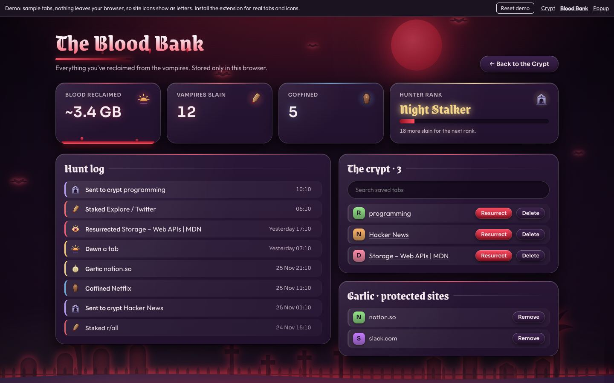
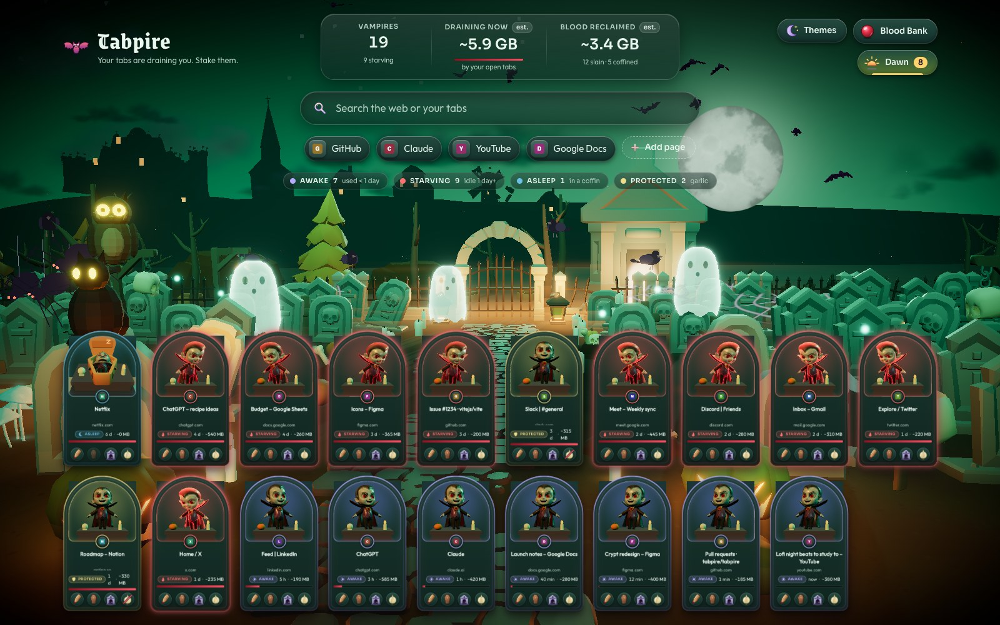
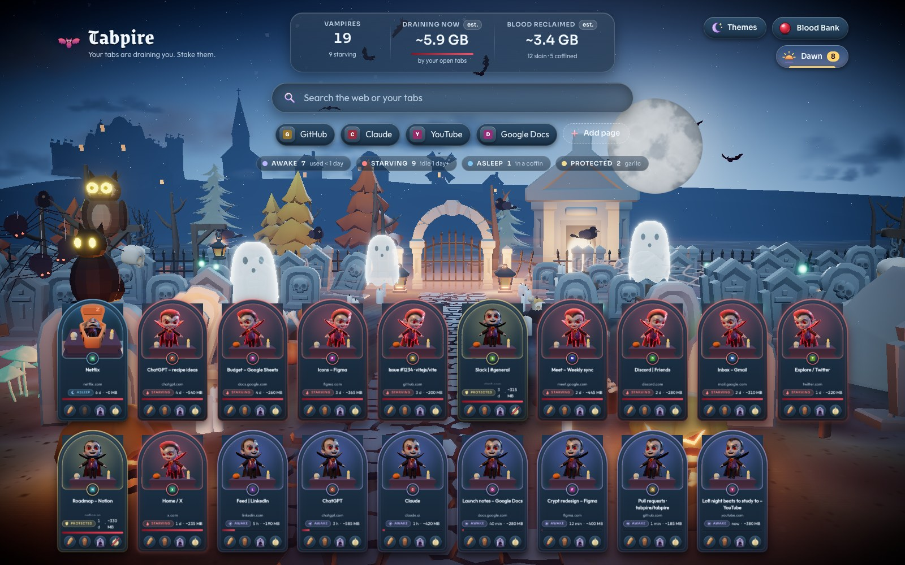

<div align="center">

# 🧛 Tabpire

**Your tabs are draining you. Stake them.**

A Chrome and Firefox new tab page where every open tab is a vampire, living in a 3D graveyard.
The longer you ignore a tab, the hungrier it gets.

[**Try the web demo**](https://tejaswip08.github.io/kiroween-tabpire/) · [Install](#install) · [How it works](#how-it-works) · [Built with Kiro](#built-with-kiro)


</div>

## How it works

Every open tab is a vampire in exactly one state:

| State | When | What you see |
| --- | --- | --- |
| **Awake** | in use, playing sound, or used in the last day | a calm vampire that follows your cursor |
| **Starving** | not used for a day or more | a hunched, pacing vampire with a red glow |
| **Asleep** | put to sleep (discarded) to free memory | it sleeps in its coffin |
| **Protected** | its site is on your garlic list | it leans back, trembling |

Each card shows the site, idle time, estimated memory (always marked `~`, since browsers don't give
per-tab memory to extensions) and a hunger bar that fills over one day. Then you deal with it:

| Action | What it does | What the vampire does |
| --- | --- | --- |
| 🗡️ **Stake** | Close the tab | topples backwards |
| ⚰️ **Coffin** | Put the tab to sleep to free memory | sinks into a rising coffin |
| 🏺 **Crypt** | Save the tab for later, then close it | turns into a bat |
| 🧄 **Garlic** | Protect every tab on that site | stays, but turns Protected and leans back |
| ☀️ **Dawn** | Close every starving tab at once, saving each to the Crypt first | burns to embers |

**Dawn is safe:** it never closes the active tab, pinned tabs, tabs playing sound, or garlic sites.
Property-based tests check this against more than a thousand random tab sets.

Saved tabs come back with **Resurrect** from the search box, which suggests your open tabs, pinned
pages and the Crypt before web results, or from the **Blood Bank**. A sleeping tab has **Wake**. The toolbar
badge shows how many tabs are starving and refreshes every minute, and the toolbar **popup** shows the
starving count with a Dawn button. Every button and state chip has a tip in the vampire's own voice.

<table>
  <tr>
    <td width="50%"></td>
    <td width="50%"></td>
  </tr>
  <tr>
    <td align="center">Hover a card: the vampire tells you how long it has waited</td>
    <td align="center">The <b>Blood Bank</b>: memory reclaimed, counts, your hunter rank and recent deeds</td>
  </tr>
</table>

## Four themes
Each theme has its own sky, moon, fog and lights, its own props and its own weather. Your choice is saved and
used on every Tabpire page.
<table>
  <tr>
    <td width="50%"><br><b>The Crypt</b>: purple night, a red moon and a quiet graveyard</td>
    <td width="50%"><br><b>Pumpkin Patch</b>: orange dusk, a barn, corn and falling leaves</td>
  </tr>
  <tr>
    <td><br><b>Witch's Forest</b>: green mist, twisted trees and fireflies</td>
    <td><br><b>Frozen Cemetery</b>: cold blue night, frosted pines and snow</td>
  </tr>
</table>
<p align="center"></p>
## Try it without installing

The [web demo](https://tejaswip08.github.io/kiroween-tabpire/) runs the real new tab page, Blood Bank and
popup in an ordinary browser tab, against an in-memory fake browser with about 20 sample tabs. Every action
and theme works, and nothing leaves your browser. **Reset demo** brings the sample tabs back.

## Install

You need Node.js 22.

```bash
npm install
npm run build            # Chrome: writes .output/chrome-mv3
npm run build:firefox    # Firefox: writes .output/firefox-mv3
```

**Chrome:** open `chrome://extensions`, turn on **Developer mode**, click **Load unpacked** and pick
`.output/chrome-mv3`. Open a new tab.

**Firefox:** open `about:debugging#/runtime/this-firefox`, click **Load Temporary Add-on** and pick
`.output/firefox-mv3/manifest.json`.

## Development

```bash
npm run dev              # opens Chrome with Tabpire loaded, with hot reload
npm run dev:firefox      # the same in Firefox
npm run typecheck
npm test                 # Vitest, including fast-check property tests
npm run demo:dev         # the web demo, in a normal browser tab
npm run demo:build       # builds the demo into demo/dist
```

Add `#fps` to the new tab address to show a small frame-rate readout.

The demo is deployed to GitHub Pages by `.github/workflows/pages.yml` on every push to `main`. The repository's
Pages setting must use the **GitHub Actions** source.

## Privacy

Tabpire is local-first: no account, no backend, no analytics. Your tabs, stats, saved tabs and settings stay in
the browser's own extension storage. Two things use the network, as a browser does on its own:

- **Search suggestions:** what you type in the search box is sent to Google's suggestion service.
- **Icons for pinned pages:** fetched from the site itself, or from DuckDuckGo's icon service if the site has none.

Permissions: `tabs`, `storage`, `alarms`, `search` and `favicon`, plus access to the suggestion service.

## Tech

- [WXT](https://wxt.dev) (Manifest V3), React 19 and strict TypeScript, for Chrome and Firefox
- three.js with React Three Fiber, drei and postprocessing: one background canvas for the graveyard, and one shared
  canvas for every card's vampire (drei `View`), built to run at 60 fps
- Plain CSS with design tokens per theme; CSS animations only change `transform` and `opacity`
- Vitest, Testing Library and fast-check
- Fonts: Grenze Gotisch, Sora and Outfit, bundled with Fontsource

## Built with Kiro

Tabpire was built for the **Kiroween 2026** hackathon with [Kiro](https://kiro.dev), spec by spec. Everything Kiro
worked from is in [`.kiro/`](.kiro):

- **Steering (product):** [`product.md`](.kiro/steering/product.md), [`style.md`](.kiro/steering/style.md) and
  [`roadmap.md`](.kiro/steering/roadmap.md)
- **Steering (tech):** [`tech.md`](.kiro/steering/tech.md) and [`structure.md`](.kiro/steering/structure.md)
- **Specs**, each with requirements, design and tasks:
  [project and tab rules](.kiro/specs/project-and-tab-rules),
  [tab actions, Dawn and badge](.kiro/specs/tab-actions-dawn-badge),
  [the Crypt page](.kiro/specs/crypt-page),
  [3D graveyard](.kiro/specs/graveyard-3d),
  [themes](.kiro/specs/themes) and
  [web demo](.kiro/specs/web-demo)
- **Hooks:** run the tests and the typecheck when a file is saved, and check that CSS keyframes only animate
  `transform` and `opacity` when a stylesheet is saved

### How this was built
An earlier prototype of the idea was made with another AI tool before the hackathon. The code in this repository
was rebuilt from scratch in Kiro for Kiroween, spec by spec. The only pre-existing assets are the CC0 3D models
(Kenney, KayKit, Quaternius) and the vampire model, listed under [Credits](#credits).

## Credits

- 3D models (CC0): [Graveyard Kit](https://kenney.nl/assets/graveyard-kit) by Kenney,
  [Halloween Bits](https://kaylousberg.itch.io/halloween-bits) by Kay Lousberg (KayKit), and models by
  [Quaternius](https://quaternius.com) from [Poly Pizza](https://poly.pizza). Licence files are in
  [`public/models`](public/models).
- The vampire: our own concept art generated with Meshy, turned into a 3D model with Tripo AI
  (free plan: public, non-commercial use).

## License

The code is [MIT](LICENSE). The Kenney, KayKit and Quaternius models are CC0. The vampire model is for
non-commercial use only.
